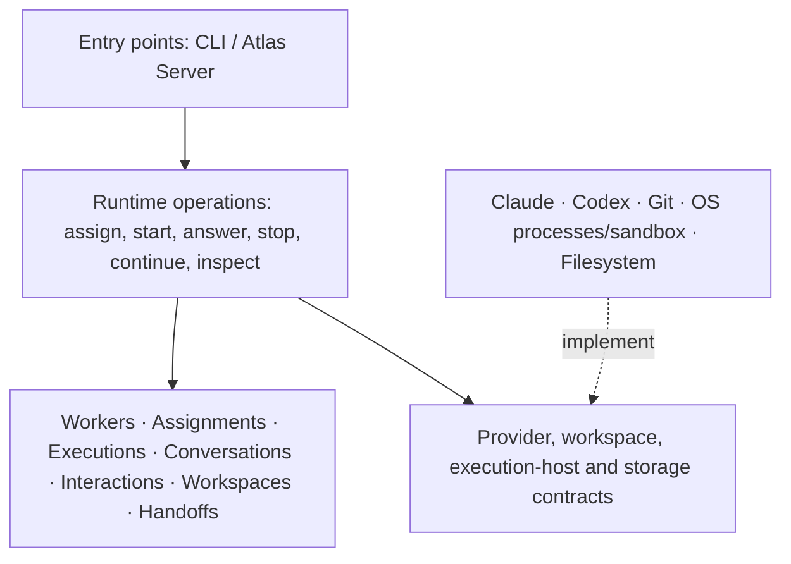

# Runtime architecture

Status: proposed target architecture, recorded from the architecture discussion with Melle. This document does not claim that the current implementation has these boundaries, nor authorize a refactor or permission changes.

## Purpose: make the architecture express the product

Runtime is a worker-execution system, not a collection of CLI wrappers. Its source structure should expose workers, assignments, executions, conversations, interactions, workspaces and handoffs. Provider names, transport protocols, process management and storage formats are implementation details below those concepts.

This is the intent of **screaming architecture**: opening the codebase should reveal what Runtime does, rather than which frameworks or external tools it uses.

Not every domain concept needs a separate layer, application, process or service. Concepts describe the business of Runtime; layers separate responsibilities and dependency direction. Prefer the smallest implementation that preserves those boundaries.

## Ownership boundary

**Runtime owns execution mechanics:** native sessions, execution identity and lifecycle, workspace preparation, permission enforcement, provider selection, local quota eligibility, interaction delivery evidence, durable records and execution events.

**Atlas Server owns orchestration:** work queues, dependencies, assignment selection, workflow gates, acceptance, merge/release policy and escalation rules. A locally installed orchestration server is Atlas Server, not a second workflow engine inside Runtime.

**Console and other clients present state and request permitted operations.** The temporary external coordinator uses the same Runtime interface that Atlas Server should consume. Neither Markdown instructions nor model output authorize workflow transitions.

## Planned local isolation and centralized GitHub access

Decision from Melle: GitHub access should be centralized, not independently available to every agent. This is a planned architecture direction, not an expansion of the current workspace-to-Go migration.

Runtime remains local-first, running native agent CLIs on macOS. Neither Linux nor a VM is required. The target implementation stack is Elixir and Go; remove Python incrementally, with no Rust planned.

### Access boundaries

- Agents receive assigned repository workspaces and private temporary storage, not unrestricted access to the user's home directory, SSH keys or cloud credentials. Worktrees alone are not isolation boundaries.
- Agents may edit, test and perform permitted local Git operations. GitHub credentials and direct authenticated GitHub access belong to a trusted local component outside agent execution sandboxes.
- Centralize GitHub reads and writes required by the workflow, including repository acquisition/fetch, push and PR operations. Workspace preparation requests remote operations through that boundary rather than exposing credentials to agent processes.
- Expose specific operations with validated repository, branch and execution context, not arbitrary shell commands or a generic authenticated HTTP proxy. Apply repository/account restrictions and narrowly scoped credentials.
- Keep permission configuration and credential material outside agent-writable locations. Agents cannot expand their own permissions.
- Atlas Server or the external coordinator still owns workflow authorization, acceptance, merge and release decisions. The local component executes authorized GitHub operations; centralizing credentials does not transfer orchestration to Runtime.

### Proposed Code application

Code is a proposed reusable Elixir OTP application for centralized code-hosting provider operations and credentials, including GitHub access. It can be embedded in a standalone Runtime release or an Atlas Server release; independent deployment is optional later, not required now. Runtime continues to own local workspaces. Orchestration remains outside Code, and standalone Runtime must not require Server or Flow.

OTP application boundaries organize responsibilities and dependencies; they are not OS security isolation. Flow, Bus and State packaging follows explicit dependencies rather than a requirement to distribute every layer independently. This migration introduces no Code application or centralized-access implementation.

### TLS relationship and limits

The current macOS Claude trust-service allowance is a verified compatibility fix, not the final isolation design. A trusted GitHub component could perform certificate verification outside the agent sandbox, allowing removal of that allowance from agents if no other required tools depend on it. Verify those dependencies before removal; never disable TLS verification.

Centralized access reduces credential exposure but is not sufficient by itself to prevent data leaving the machine. Its operation surface must not permit arbitrary destinations, repositories or accounts. Approved publishing operations can still transmit workspace content; authorization must constrain where and what may be published.

### Later implementation sequence

1. Inventory current GitHub callers and credential paths, including workspace acquisition and agent commands.
2. Introduce the smallest local GitHub operation boundary using existing Runtime contracts and components; no separate daemon or framework unless required.
3. Migrate every caller, remove agent credential inheritance and direct authenticated GitHub paths, and enforce the boundary in the execution environment rather than relying on prompts.
4. Exercise normal clone/fetch/push/PR behavior and refusals for unauthorized repositories, branches and operations. Verify agents cannot read the centralized credentials.
5. Check remaining tool dependencies on macOS trust services and remove the agent allowance only where real behavior still works.

Open implementation details: exact operation contract, credential source/scopes and enforceable native macOS read/network restrictions. These require code inspection and runtime proof; this document does not claim they are implemented.

## Domain concepts

| Concept | Responsibility and boundary |
|---|---|
| Worker | Stable identity across assignments. Identifies the current execution; does not select work from a queue. |
| Assignment | Explicit work request: instructions, repository, base revision and required capabilities. An assignment is not a native conversation. |
| Execution | One attempt to perform an assignment. Owns lifecycle, cancellation, outcome and failure. Distinct from worker identity. |
| Conversation | Provider-bound native session and continuation context. May be reused only when its identity, workspace and permissions remain compatible. |
| Interaction | A question and its answer, including admission, delivery, processing and invalidation evidence, bound to exact executions. |
| Workspace | Repository acquisition, fresh branches, ownership and continuation compatibility. Does not choose assignments or merge work. |
| Execution policy | Local provider/model selection, quota eligibility, fallback and capability requirements. Cannot silently weaken permissions or required capabilities. |
| Handoff | Declared completion or PR result, revisions, verification evidence, limits and remaining processes. A handoff is not acceptance or merge. |

Events and persistence support these concepts. They should not become the primary organizing idea of the architecture.

## Layers and dependencies



The arrows describe dependencies, not a requirement that every request traverse every box. Domain rules must not import provider implementations, subprocess protocols or transport formats. Adapters implement contracts owned by the Runtime core.

### 1. Domain: what Runtime means

The domain defines identity, state transitions and invariants:

- A worker has at most one active execution.
- An answer targets one question in one exact execution; it must not reach a replacement attempt implicitly.
- Continuation preserves a compatible conversation, workspace and permission scope.
- Stopping an execution invalidates its pending interactions.
- Execution completion does not imply task acceptance or successful verification.
- Recording a handoff does not merge a PR or issue a new assignment.
- Delivery, native processing and verified task success are distinct facts.
- Unknown outcomes remain unknown; they are not permission to replay side effects.

No provider names, shell commands, socket formats or filesystem serialization belong in these rules.

### 2. Runtime operations: what callers can do

Application operations coordinate domain transitions and infrastructure:

- Admit an explicit assignment and start execution.
- Continue a compatible conversation.
- Answer an exact pending question.
- Stop an owned execution.
- Submit or inspect a handoff.
- Inspect execution state, output and history.
- Reconstruct durable state after reconnect.

This layer handles request identity, admission ordering and deduplication. Those rules must not be reimplemented separately in provider adapters. Durable admission is not proof that a provider executed a task, and uncertain launch outcomes must not cause automatic redispatch.

It does not select backlog work, approve results, merge PRs or deploy. Those remain orchestration responsibilities.

### 3. Contracts: what Runtime requires from infrastructure

The provider contract should cover the complete execution and interaction lifecycle:

- Describe capabilities before admission.
- Start or resume a native conversation.
- Emit normalized identity, output, question, completion and failure events.
- Deliver an answer to the exact native interaction and report the evidence the provider actually exposes.
- Stop execution through the owned execution-host mechanism.

Runtime asks whether a provider supports active questions; it must not encode that rule as `backend == "claude"`. Claude and Codex translate their native protocols into the same Runtime interaction contract. They must not introduce separate question stores or parallel public APIs.

Capability differences remain explicit. A provider that cannot satisfy an assignment's required interaction or permission contract must refuse before execution where possible. Fallback cannot silently discard those requirements. Changing providers starts a new conversation with an explicit handoff; it is not continuation of the old native session.

Separate infrastructure contracts cover workspace preparation, execution hosting and storage. These are dependency boundaries, not justification for a plugin platform or generic framework.

### 4. Adapters: how execution happens

| Adapter | Responsibility |
|---|---|
| Claude | Translate Claude's native protocol, session configuration and interaction evidence into Runtime contracts. |
| Codex | Translate Codex's native protocol, session configuration and interaction evidence into the same contracts. |
| Git workspace | Prepare repositories and branches, and inspect ownership and compatibility. |
| Execution host | Own OS processes and process groups, signals, environment setup and application of the authorized sandbox. |
| Storage | Persist domain records and event replay with explicit durability and retention limits. |

Provider-specific sandbox configuration may require provider-specific translation, but the authorized scope and enforcement contract must remain explicit. An adapter must not expand permissions to make an operation succeed.

The target implementation is Elixir and Go: Elixir owns lifecycle and state; Go owns the native integration responsibilities as their boundaries are established. The finished architecture contains no Python and introduces no Rust. Python remains temporarily while responsibilities move out of the mixed runner one bounded, runnable slice at a time. A language rewrite is not a substitute for establishing the boundary first.

### 5. Entry points: how callers reach Runtime

The CLI and Atlas Server-facing transport translate requests into the same application operations and expose their results. They should not each implement a worker manager, provider-selection policy or interaction lifecycle.

Transport-specific parsing and presentation remain at the edge. A truncated status summary must not substitute for full output or a structured handoff record.

## Current implementation versus this target

The current layout groups both execution paths by responsibility without treating their different contracts as interchangeable:

```text
beam/apps/atlas_runtime/lib/atlas_runtime/
  application.ex
  entrypoints/socket.ex
  execution/{service,command_admissions,backend_policy,identity,engine,turn,settings,faults}.ex
  interactions/{commands,native_question,question_records,peer_question_records,guidance,output}.ex
  handoffs/{commands,handoff_records}.ex
  persistence/{history,execution_events}.ex
  workspaces/workspace.ex
  host/native.ex
  providers/{agent,input,native_events,claude,fake_inbox,stub}.ex
  integrations/atlas_server/{talk,output_endpoint,broker,commands}.ex

beam/apps/atlas_runtime/priv/runtime/
  entrypoint.py
  protocol.py
  host/{process,assignment,sandbox}.py
  providers/{claude,claude_questions,codex}.py
  workspaces/client.py

tools/runtime/
  go.mod
  main.go
  workspace/{workspace,workspace_test}.go
```

Existing public Elixir module names remain stable where their contracts remain valid. The standalone `AtlasRuntime.Service` is still the serialized execution owner, and `AtlasRuntime.Agent.Native` still owns its port, process monitoring and cancellation. Their source locations no longer imply that socket framing, workspace validation, provider interpretation and every durable operation belong inside those two modules.

Dependencies and responsibilities:

- The Go CLI sends commands through `Entrypoints.Socket` to `Service`. Socket framing, connection ownership and response-before-shutdown remain at the edge.
- `Service` selects backends and admits, starts and stops executions. Interaction commands own question admission, native delivery and peer correlation; handoff commands own declaration submission and inspection. Neither operation module calls back into `Service`.
- `Persistence.History` owns recovery, saved-turn ownership checks, historical projections, output reads and ordered terminal checkpoints. Record modules retain their bounded storage, outboxes and publication rules. Persistence does not dispatch commands.
- `Workspaces` calls the launching executable's Go workspace command directly. Admission no longer depends on the native provider host for path, scope or repository-request validation.
- The native host delegates pending-question validation, timers and delivery evidence to `Interactions.NativeQuestion`, and native identity/output/result interpretation to `Providers.NativeEvents`. The host clears question controls on terminal provider state; provider interpretation does not own cancellation.
- The thin Python entrypoint calls the host process loop. Host modules own process groups, control transport, sandbox mechanics, workspace ownership lifetime and cleanup. Provider modules own native command construction, question protocol, resume context and model/session interpretation. Both depend on the shared protocol codec; provider modules do not import host lifecycle code.
- The Go CLI imports the dependency-free local `workspace` package. That package does not import the CLI or choose a provider.

`Engine`, `Turn`, engine settings and test-environment fault injection belong to execution lifecycle, not a `connected/` mode bucket. `Guidance` owns exact-attempt queued-input reconciliation; `Output` owns bounded ephemeral public-output retention, not durable history. They live under `interactions/`. The existing provider and proof adapters live beside the `Agent` contract in `providers/`.

Only actual Atlas communication remains under `integrations/atlas_server/`: State read/fact transport (`Talk`), the address-validated Bus/BFF output endpoint, the Atlas command broker, and Atlas-only command setup. `Commands` owns Atlas prompts, help discovery, bridge configuration and the confined command environment/wrapper/profile previously embedded in the Claude adapter. The adapter retains Claude argv, event interpretation and process lifecycle, consumes that setup, and has no forwarding copies of the extracted helpers. The command setup uses the broker and never calls the provider; the output endpoint reads the independent output buffer.

These execution paths remain distinct. `Engine` reconciles ownership and leases through Atlas facts and starts `Turn`; standalone `Service` admits explicitly requested native executions and stores its own history. Grouping them by responsibility does not add a shared workflow engine, unify queued guidance with native questions, or enable either protocol on the other adapter. Existing module APIs for unchanged responsibilities remain stable. Standalone startup still requires neither Atlas Server nor Flow, and its native host/Python implementation is unchanged by this correction.

## Implemented workspace boundary

Workspace preparation and ownership live in `tools/runtime/workspace/workspace.go`, exposed through internal `atlas-runtime workspace` operations. The package owns canonical-path and repository-request validation, exclusive repository locking, clone/fetch/fresh-branch preparation and continuation preservation. Both Claude and Codex use the same implementation.

The launching CLI passes its own executable path to the daemon through `ATLAS_RUNTIME_EXECUTABLE`; workspace calls never discover a different installed binary or compile code during execution. Elixir invokes the Go command directly for admission queries. `priv/runtime/workspaces/client.py` only transports the runner requests and receives the ownership descriptor; the superseded Python workspace implementation is removed.

Preparation accepts the existing scope/repository records, creation flag and explicit sandbox command prefix. Go owns Git arguments and validation, not provider selection or sandbox translation. It returns the prepared record, including fetched base SHA, or refuses without resetting, stashing or overwriting work. Git subprocesses inherit the existing execution process group.

For ownership, Go transfers the locked directory descriptor over a local Unix socket using `SCM_RIGHTS`. The helper exits; the original runner retains the same open-file-description lock until its existing native process-group cleanup completes. No new supervisor, lock-file protocol or persistent helper is introduced.

The workspace Go translation is complete. This responsibility split deliberately retains the remaining Python host/provider implementation; it is not another language migration. Lifecycle and durable state stay in Elixir.

The shared provider capability and interaction contract remains a separate architectural goal. Claude-only question admission is still explicit, and Codex question support is not part of this extraction. Execution identity, permission checks, error handling, delivery evidence and durable records retain their existing contracts. The proposed centralized GitHub/Code OTP application above remains future work, not an implemented service or dependency.

## Authorized macOS Claude TLS allowance

Claude dedicated-repository settings allow only `com.apple.trustd.agent` through `sandbox.network.allowMachLookup` on macOS. This fixes the observed native `gh` certificate-validation failure without disabling TLS verification or the sandbox. Other platforms receive no Mach lookup allowance.

The allowance applies to every sandboxed command, not only `gh`. Access to the host trust service permits service-mediated networking, so effective isolation is weaker than a strict GitHub-only network boundary. The existing allowed domains, filesystem restrictions, fail-closed setting and prohibition on unsandboxed commands remain unchanged. This is one explicitly authorized allowance, not permission for adapters to widen scope automatically.

## Explicit non-goals

- Orchestration or LLM-interpreted workflow authority inside Runtime.
- Automatic assignment, merge, release or retry of uncertain side effects.
- Additional permission expansion beyond the explicitly authorized TLS allowance, new providers or a generic plugin framework.
- Claims of exactly-once provider execution or automatic crash restoration.
- Treating coordinator-routed peer records as authenticated native peer delivery.
- Treating stored declarations as independently verified results.

<sub>Written by an AI agent (omp · openai-codex/gpt-6-astra).</sub>
