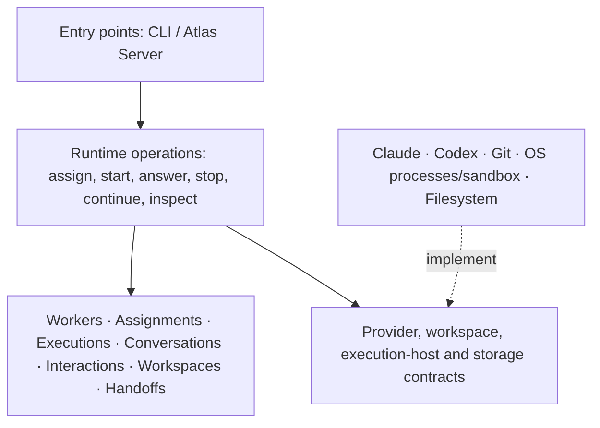

# Runtime architecture

Status: proposed target architecture, recorded from the architecture discussion with the operator. This document does not claim that the current implementation has these boundaries, nor authorize a refactor or permission changes.

## Purpose: make the architecture express the product

Runtime is a worker-execution system, not a collection of CLI wrappers. Its source structure should expose workers, assignments, executions, conversations, interactions, workspaces and handoffs. Provider names, transport protocols, process management and storage formats are implementation details below those concepts.

This is the intent of **screaming architecture**: opening the codebase should reveal what Runtime does, rather than which frameworks or external tools it uses.

Not every domain concept needs a separate layer, application, process or service. Concepts describe the business of Runtime; layers separate responsibilities and dependency direction. Prefer the smallest implementation that preserves those boundaries.

## Ownership boundary

**Runtime owns execution mechanics:** native sessions, execution identity and lifecycle, workspace preparation, permission enforcement, provider selection, local quota eligibility, interaction delivery evidence, durable records and execution events.

**Atlas Server owns orchestration:** work queues, dependencies, assignment selection, workflow gates, acceptance, merge/release policy and escalation rules. A locally installed orchestration server is Atlas Server, not a second workflow engine inside Runtime.

**Console and other clients present state and request permitted operations.** The temporary external coordinator uses the same Runtime interface that Atlas Server should consume. Neither Markdown instructions nor model output authorize workflow transitions.

## Planned local isolation and centralized GitHub access

Decision: GitHub access should be centralized, not independently available to every agent. This is a planned architecture direction, not an expansion of the current workspace-to-Go migration.

Runtime remains local-first, running native agent CLIs on macOS. Neither Linux nor a VM is required. The implementation stack is Elixir and Go; Python has been removed from Runtime, and no Rust is planned.

### Access boundaries

- Agents receive assigned repository workspaces and private temporary storage, not unrestricted access to the user's home directory, SSH keys or cloud credentials. Worktrees alone are not isolation boundaries.
- Agents may edit, test and perform permitted local Git operations. GitHub credentials and direct authenticated GitHub access belong to a trusted local component outside agent execution sandboxes.
- Centralize GitHub reads and writes required by the workflow, including repository acquisition/fetch, push and PR operations. Workspace preparation requests remote operations through that boundary rather than exposing credentials to agent processes.
- Expose specific operations with validated repository, branch and execution context, not arbitrary shell commands or a generic authenticated HTTP proxy. Apply repository/account restrictions and narrowly scoped credentials.
- Keep permission configuration and credential material outside agent-writable locations. Agents cannot expand their own permissions.
- Atlas Server or the external coordinator still owns workflow authorization, acceptance, merge and release decisions. The local component executes authorized GitHub operations; centralizing credentials does not transfer orchestration to Runtime.

### Code service: contract (implemented: references, snapshots, changes, reviews, integrations)

Status: every endpoint below (health, reference resolution, snapshot creation, manifest, archive, change submission, review and integration) is implemented in `beam/apps/atlas_code`. Clients see repository names, reference names, `sha256:` snapshot IDs, opaque `rev_<64 hex>` revision handles and their own UUIDs; commits, branches, refs, remote URLs and Git output stay inside Code. Runtime can materialize a snapshot, inspect it offline and submit a repository's changes as a sealed change with its own revision handle with `atlas-runtime snapshot materialize|status|diff|submit|rebind` (below); reviews and integrations are requested by the orchestrator, not by Runtime. Managed worker starts do not use snapshots yet. Everything under "Current callers" was cited from source at `f4492cbeb0f199b0228282c507ae6f8f05b05596` and is kept as that record. The earlier commit-, publication- and release-based contract is superseded; see "Superseded design" below.

Decisions that this contract follows:
- Code is a separate local Elixir service beside Runtime, reached over authenticated loopback HTTP. The same contract can later be hosted on Atlas Server. No VM, Linux, filesystem mount or private Git server is required, and Runtime keeps working without Atlas Server.
- Code owns Git metadata, repository/provider credentials and Git operations.
- Runtime materializes snapshots into one or more temporary ordinary worker folders. Workers receive folder paths only: no Git metadata, no Code API, no credentials.
- Immutable baselines stay outside worker access. Local read-only status/diff must work offline before the current Git access is withdrawn. Text and binary bytes, deletions, executable modes and symlinks are preserved.
- Changes upload against an exact snapshot and base. Uploading does not authorize a commit, PR or release; the trusted external orchestrator authorizes publication separately. Nothing is silently rebased or overwritten.
- The first proof is the full local Code + Runtime + one external orchestrator workflow. Server and Console work stay parked. Existing trusted development-agent Git/PR access remains until the replacement is proven.

#### Current callers (implemented)

| Responsibility today | Where | Moves to |
|---|---|---|
| Validate a GitHub HTTPS URL and a new branch name; derive the managed clone path and dedicated scope | `tools/runtime/workspace/workspace.go` `workspaceRequest` (`git check-ref-format`), called by Elixir `Workspaces.repository_request` (`workspaces/workspace.ex:19`) from `Service.worker_command` start (`execution/service.ex:178`) | URL/branch validation: Code. Worker-folder path: Runtime. |
| Clone, fetch, check origin, refuse dirty state and existing branches, create the task branch at fetched `origin/develop` | `workspace.Prepare` (`workspace.go:491–628`). Git runs inside the worker's Codex sandbox prefix (`host.go:497–506`) with `credential.helper=!gh auth git-credential`, writing `.git/atlas-runtime-repository.json` | Code (resolve, snapshot). The clone and branch disappear from worker folders. |
| Repository scope, canonical root and Git metadata location | `workspace.Scope` (`workspace.go:291`) and `DedicatedScope` (`:143`, `network_hosts: github.com, api.github.com`); Elixir `Workspaces.permission_scope` at start and continuation (`service.ex:201,229`) | Runtime (folder scope only; the Git fields drop out) |
| Saved Claude cwd/branch/origin identity for continuation | `workspace.Context` (`workspace.go:176`) via `host.saveContext` (`claude.go:385`); `claude-context.json` read at `service.ex:235` | Runtime, against a snapshot ID instead of a branch/origin |
| Directory ownership | `workspace.Lock` (`workspace.go:394`), held by `native-host` until the group is reaped (`host.go:179`) | Runtime (unchanged) |
| Worker GitHub network access | Codex profile `github.com`/`api.github.com` (`host/codex.go:50`); Claude `allowedDomains` from `network_hosts` plus the macOS trustd allowance (`host/claude.go:245–273`). Workers use the user's `gh` login | Removed once Code publishes |
| Handoff identity | `handoff_records.ex:11,193`: `repository_url`, `branch`, `base_sha`, `head_sha`, `pr_url` declared by the coordinator and bound to saved repository metadata | Orchestrator declares; Code later verifies against the change and publication |
| Atlas-connected path | `integrations/atlas_server/*` and `providers/claude.ex` contain no Git or GitHub calls (searched) | No change |
| Run metadata | Saved `repository: {url, branch, base_sha}` (`command_admissions.ex:200–207`); `runtime.repository_prepared` (`host/native.ex:217`) | Adds `snapshot_id` |
| CLI | `atlas-runtime start --repo URL --branch NAME --permissions dedicated-repository` (`tools/runtime/main.go`) | Unchanged in step 2 |
| Credentials | Only the user's existing `gh` login, read through Git's credential helper. No token is stored by Runtime | Code only |
| Local diff | Native agents and the coordinator run `git status`/`git diff` in the worker clone; Runtime has none | Runtime, offline against the baseline |
| Workflow authorization | The external coordinator (inbox workflow) | Orchestrator, unchanged |
| Snapshots and change uploads | None | Code stores them; Runtime materializes and uploads |
| Publication and release | Development agents push with `gh`; the coordinator merges | Code, authorized only by the orchestrator |
| Uncommitted bytes across continuation | `Prepare` keeps them, refusing branch drift (`workspace.go:584–592`) | Runtime keeps the worker folder per execution |
| Exact base | `base_sha` from `rev-parse refs/remotes/origin/develop` (`workspace.go:618`) | Code `resolve` |
| Repository allow-list | Regex accepts any `github.com/OWNER/REPO` | Code configuration lists allowed repositories |
| macOS trustd allowance | Required for worker `gh` | Removable once workers no longer contact GitHub (verify first) |
| Multi-repository | One repository per execution | Manifest with several repositories, each at its own path |

#### Who does what

| | Code | Runtime | Orchestrator |
|---|---|---|---|
| Resolve a reference to a revision handle | performs | — | chooses repository and reference |
| Snapshot (manifest and archive) | creates and serves | downloads and materializes into worker folders, keeps an immutable baseline outside worker access | — |
| Local status/diff | — | computes offline: worker folder against baseline | reads |
| Change upload and seal | stores against the exact base revision | builds entries from the diff, uploads and seals them | — |
| Review (location, pull request) and integration (target update) | performs | — | authorizes each one explicitly |
| Credentials and Git metadata | only holder | never | never |

Workers only ever see their folders.

#### Transport and errors (implemented)

Code listens only on `127.0.0.1` with a configured port, using OTP `:inets` `httpd`; Runtime's Go CLI calls it with the Go standard library. Every request, health included, carries `Authorization: Bearer <token>`.

There are two tokens, each in an owner-only (0600) regular file under the Code home:
- the **runtime token** allows health, reference resolution, snapshot and change operations;
- the **orchestrator token** (optional, different from the runtime token) allows everything, including reviews and integrations. Without it, every review and integration is `403 forbidden`.

Runtime never passes either token to native workers; `Agent.Native` already strips all but a fixed environment list.

**Known limit:** a same-user token file is not hidden from a worker that can read the user's home directory, e.g. a Codex read-only sandbox. This contract does not claim worker isolation from Code; that belongs to the later isolation work.

Every error response is `{"error": {"code": "<code>", "message": "<text>", "details": {}}}` with the HTTP status shown:

| Status | Codes |
|---|---|
| 400 | `invalid_request` |
| 401 | `unauthorized` |
| 403 | `forbidden` (wrong token, repository not allowed, reviews and integrations not configured) |
| 404 | `not_found`, `unknown_reference`, `unknown_revision` |
| 405 | `method_not_allowed` |
| 409 | `snapshot_superseded`, `repository_mismatch`, `base_mismatch`, `conflict`, `change_not_sealed`, `location_taken`, `review_not_open`, `review_has_no_target`, `revision_mismatch`, `fingerprint_mismatch`, `target_moved`, `integration_conflict`, `integration_refused` |
| 413 | `payload_too_large` |
| 422 | `incomplete_upload`, `unsupported_content` |
| 502 | `review_incomplete` |
| 503 | `provider_unavailable` |

Responses are JSON, except archive and blob bodies, which are bytes.

#### Endpoints (implemented)

1. **Health.** `GET /v1/health` → `{"service": "atlas-code", "version": "…"}`.
2. **Reference resolution.** `POST /v1/references/resolve`
   - Request: `{"repository": "github.com/eyra/atlas", "reference": "develop"}`, exactly these two keys. The reference must be a valid branch name.
   - Response: `{"repository", "reference", "revision": "rev_<64 hex>"}`. An unknown reference is `404 unknown_reference`.
   - Read-only (`git ls-remote`). A revision handle is the SHA-256 of its repository and commit, so it never changes; Code records it under `revisions/` before any reply carries it, and a handle of another repository is `409 repository_mismatch`.
3. **Multi-repository snapshot.** `POST /v1/snapshots`
   - Request: `{"repositories": [{"repository": "github.com/eyra/atlas", "revision": "rev_<hex>", "path": "atlas"}]}`.
   - Paths are relative, unique and non-overlapping.
   - Response: `{"snapshot_id": "sha256:<digest of the canonical manifest>", "repositories": [{"path", "repository", "revision"}]}`.
   - Idempotent: the same request returns the same ID. An unknown handle is `404 unknown_revision`; a revision on no branch of the remote is `404 not_found`.
4. **Snapshot manifest.** `GET /v1/snapshots/{id}/manifest` → `{"snapshot_id", "version": 2, "repositories": [{"path", "repository", "revision"}], "entries": [{"repository", "path", "kind": "file|symlink", "mode": "100644|100755|120000", "size", "sha256", "target"?}]}`. The `target` field is present for symlinks only. A snapshot from before revision handles is `409 snapshot_superseded` with `details.successor`, the ID of its version 2 counterpart.
5. **Snapshot archive.** `GET /v1/snapshots/{id}/archive?path=atlas` → a tar stream of the working tree only: no `.git`, no credentials, modes and symlinks preserved. Runtime verifies each entry against the manifest before materializing it.

Snapshots as implemented:
- **Cache:** Code keeps one private bare repository per allowed repository under `$ATLAS_CODE_HOME/cache/`. It fetches all branches with its credential helper when a requested revision's commit is missing. Only commits reachable from a branch can be snapshotted; anything else is a 404. Snapshot manifests are stored once, atomically, under `$ATLAS_CODE_HOME/snapshots/`.
- **Identity:** the snapshot ID is the sha256 of the canonical (sorted, compact) `{"entries", "repositories", "version": 2}` JSON. Request order does not matter, and the revision handles are part of the identity. The manifest response also returns `repositories` and `version`, so Runtime can recompute the ID.
- **Exact bytes:** manifest digests and archive contents are Git blob bytes as stored. `.gitattributes` effects (export-subst, export-ignore, filters, line-ending conversion) are never applied, which is why Code builds the archive itself instead of using `git archive`.
- **Archive:** tar member names are relative to the repository root. Files have mode 0644 or 0755 and symlinks are tar symlinks. There are no directory entries and no `.git`. Headers are deterministic (mtime 0, uid/gid 0, pax for names over 100 bytes). The archive is streamed blob by blob with a `Content-Length`.
- **Refused content:** `422 unsupported_content`, listing every offending entry, for:
  - submodules (gitlinks);
  - symlinks whose target is absolute, empty, not UTF-8 or escapes the repository root;
  - file paths that are not UTF-8, contain control characters or backslashes, or have a `.git` segment;
  - any other mode.
- **Request errors:** unsafe snapshot paths and duplicate or nested paths are `400 invalid_request`, with the offending paths in `details`.
- **LFS:** pointer files are ordinary bytes and are not expanded.
- **Limits:** no timeout on Code's `git fetch`; archive reads time out after 60 s without data. Concurrent snapshots of the same repository are serialized but were not stress-tested. Files of 8 GiB or more are untested.
6. **Change submission.** Three requests:
   1. `POST /v1/changes` with `{"change_id": "<caller UUID>", "snapshot_id", "repository", "base_revision", "entries": [{"path", "op": "write|delete", "kind", "mode", "size", "sha256", "target"?}]}`.
      - `base_revision` must equal that repository's revision in the snapshot; otherwise `409 base_mismatch` with the snapshot's `revision`.
      - The response is `{"change_id", "state": "open", "missing": [<sha256>…]}`, or the sealed state below.
      - Repeating with the same `change_id` and identical body is idempotent; a different body is `409 conflict`.
   2. `PUT /v1/changes/{id}/blobs/{sha256}` with the bytes. Code verifies the digest and size. Re-uploading the same blob is a no-op.
   3. `POST /v1/changes/{id}/seal`.
      - Refuses with `422 incomplete_upload` and the missing digests until every blob is present.
      - Then builds a commit whose parent is exactly the base revision's commit on a Code-private ref, and returns `{"change_id", "state": "sealed", "missing": [], "revision": "rev_<hex>"}`.
   - Open (unsealed) changes are never visible to reviews and may expire; sealing is the only transition.

   Change submission as implemented:
   - **Body limits:** change IDs are canonical lowercase UUIDs. JSON bodies are capped at 16 KiB, except `POST /v1/changes` at 1 MiB; blobs are capped at 64 MiB, and anything larger gets `413 payload_too_large`.
   - **Entry paths** are repository-relative and pass the same path check as snapshots.
   - **Entry shapes:**
     - delete: `{path, op}`;
     - file write: `{…, kind: "file", mode: 100644|100755, size, sha256}`;
     - symlink write: `{…, kind: "symlink", mode: 120000, target, size, sha256}`, where size and digest are those of the target bytes. Code stores the target itself, so symlinks are never listed in `missing`.
   - **Deletes** must name a file or symlink in the base.
   - **Replacements must be explicit:** writing a file where a base directory had entries, or writing under a base file, requires deleting every replaced base path. Otherwise the request is `400` with the conflicting paths.
   - **Written symlink targets** use the snapshot symlink rule; a violation is `422 unsupported_content`.
   - **Repeats:**
     - an identical body (entry order ignored) returns the current state;
     - a different body is `409 conflict`;
     - a blob upload is verified for size and digest and is a no-op when repeated;
     - an unreferenced digest is `404`.
   - **Seal:**
     - Builds the tree in Code's private cache with a temporary index (no checkout, no `.gitattributes` filters), then runs `commit-tree` on the base commit.
     - Leaves out every written path that is new to the base and that Git ignores, as `git add -A` would: `git check-ignore --no-index` judges it against the resulting tree's `.gitignore` files (the base's and any the change writes, nested ones included). A path tracked in the base stays even when a pattern matches it. `core.excludesFile` does not apply. The response does not list what was left out, and Runtime still uploads those blobs. Runtime's `status`, `diff` and `submit` run without Git and still report and send ignored files.
     - Author and committer are `Atlas Code <atlas-code@localhost>`, with the base commit's committer date, so the same change always produces the same commit and revision. The message is `Atlas change <id>`.
     - Creates the private ref `refs/atlas/changes/<id>` without overwriting. A repeated seal returns the recorded revision.
     - Nothing is pushed and `refs/heads` is never touched; a moved source branch does not change the parent.
   - **Limits:**
     - a blob upload is held in memory (up to 64 MiB) before its size is checked;
     - a body over 64 MiB gets httpd's HTML 413 page;
     - a Git failure during seal returns a plain 500;
     - open changes are never cleaned up, and there is no `GET /v1/changes/{id}`; repeat the `POST` instead;
     - concurrency and a crash during seal were not tested.
7. **Review.** `POST /v1/reviews`, orchestrator token only.
   - Request: `{"review_id", "change_id", "target", "title", "body", "fingerprint"?}`, exactly these keys. IDs are lowercase UUIDs, `target` is the reference the review proposes to change (for example `develop`), `title` is one non-empty line of at most 256 characters, and `body` must contain "Written by an AI agent".
   - Repository and revision come only from the sealed change: an unknown change is `404`, an open one `409 change_not_sealed`, a repository no longer allowed `403`.
   - With the optional `fingerprint` (`fpr_<64 hex>`), Code recomputes the change's repository fingerprint from its stored `request.json` without `change_id`, exactly as Runtime's submit does (see the fingerprint under submit below). A different value is `409 fingerprint_mismatch` with `{change_id, fingerprint}`, the change's actual fingerprint; no review is recorded and nothing is pushed. Without the field the review behaves as before.
   - Code makes the sealed revision visible on the remote at a location only Code names, `work/review-<review_id>`, with a create-only push that never moves an existing location (`409 location_taken`). On an `https://github.com/OWNER/REPO` remote it also opens a pull request from that location to `target`, adopting the single existing one for the location; on any other remote the pushed location is the review.
   - Response: `{"review_id", "change_id", "repository", "target", "revision", "state": "open", "review_url"?}`.
   - `reviews/<id>.json` records the request and phase before each remote effect: `pushing` → `pushed` → `open`, or `failed` when the location already existed. An identical repeat resumes from the recorded phase; a different body under the same ID, another or an added or dropped `fingerprint` included, is `409 conflict`. A refused fingerprint records nothing, so its ID stays free. A pushed review without its pull request is `502 review_incomplete` with `{phase: "pushed"}`, never success.
   - Git failures are `503 provider_unavailable` with the exit status only; raw Git or `gh` output never reaches a response. `config.json` may set `"gh"` to the `gh` executable; the default is `gh` on PATH, using Code's own `gh` login.
   - **Limits:** all reviews are serialized by one lock, including remote calls. A failed review's location claim is permanent.
8. **Integration.** `POST /v1/integrations`, orchestrator token only.
   - Request: `{"integration_id", "review_id", "revision", "target_revision", "fingerprint"?}`. `revision` must be the open review's revision (`409 revision_mismatch`, `409 review_not_open`); `target_revision` is the target's revision the orchestrator verified, from `references/resolve`.
   - With the optional `fingerprint`, Code checks it against the review's current change, so the target only receives the approved content: a different value is `409 fingerprint_mismatch` with `{change_id, fingerprint}`, before any record or remote effect, and the target is unchanged.
   - Code moves the review's target from exactly `target_revision` to the review: `already_integrated` when the target already contains it, `fast_forward` when possible, otherwise a `merge` built in Code's cache with a fixed identity and date. The push carries a lease on `target_revision`, so it never replaces work Code has not seen, and branch policy is never bypassed.
   - Response: `{"integration_id", "review_id", "repository", "target", "revision", "method": "already_integrated|fast_forward|merge", "state": "integrated"}`, where `revision` is the target's new revision.
   - Terminal refusals leave the target unchanged: `409 target_moved` with `{target, current}` (resolve again and use a new `integration_id`), `409 integration_conflict` with the conflicting `paths`, `409 integration_refused` when the remote refuses the update. A review migrated from a publication without a pull request has no target: `409 review_has_no_target`.
   - `integrations/<id>.json` records every outcome, which is replayed for the same request; only `integrating` resumes. A different body under the same ID, another or an added or dropped `fingerprint` included, is `409 conflict`. All integrations are serialized by one lock.

All mutating requests carry caller-chosen IDs. A repeated identical request returns the recorded result, the same rule as Runtime admissions.

#### Superseded design: commits, publication and release

**Superseded** by the endpoints above when Code moved to revision handles (step 8). It is kept as the record of the earlier contract and its evidence; do not call these endpoints or fields. `mix atlas_code.migrate` adds a revision handle for every recorded commit, a version 2 successor for every older snapshot, a `request.json` (and `revision`) for every change and a review for every publication, keeping its branch as the review location; it rewrites no existing record, and Code refuses to start until it is complete.

| Superseded | Current |
|---|---|
| `POST /v1/revisions/resolve` with `ref`, returning `commit` | `POST /v1/references/resolve` with `reference`, returning `revision` |
| snapshot repositories with `commit` | with `revision` |
| change `base_commit`, seal returning `commit` | `base_revision`, seal returning `revision` |
| `POST /v1/publications` (`publication_id`, `branch: "work/…"`, optional `pull_request`) | `POST /v1/reviews`; Code names the location |
| proposed `POST /v1/releases` (`release_id`, `pr_url`, `expected_head`) | `POST /v1/integrations` with `target_revision` |
| `404 unknown_ref`, `409 branch_exists`, `502 publication_incomplete` | `404 unknown_reference`, `409 location_taken`, `502 review_incomplete` |

The superseded publication and release text, as it stood:

> 7. **Publication.** `POST /v1/publications`, orchestrator token only.
>    - Request: `{"publication_id", "change_id", "branch": "work/…", "pull_request": {"base": "develop", "title", "body"}?}`.
>    - Code pushes the sealed commit to a new branch: create-only, never forced (`409 branch_exists`). It opens the PR when one is requested.
>    - Response: `{"publication_id", "branch", "commit", "pr_url"?}`.
>    - If `develop` has moved, the PR shows the conflict; Code does not rebase.
>
>    Publication as implemented:
>    - **Authorization:** an optional `$ATLAS_CODE_HOME/orchestrator.token` (regular file, not a symlink, mode 0600 or stricter, non-empty, different from the runtime token; otherwise start is refused) enables publication. The orchestrator token is accepted on every endpoint. The runtime token gets `403 forbidden` "Publication requires the orchestrator token". Without an orchestrator token, publication is `403` "Publication is not configured". Tokens are compared as SHA-256 digests in constant time.
>    - **Request rules:**
>      - Unknown keys are refused, and the body is capped at 16 KiB.
>      - `branch` must start with `work/` and be a valid branch name.
>      - PR `title` must be one line of at most 256 characters, and the PR `body` must contain "Written by an AI agent".
>      - Repository, base and commit come only from the stored change. Unknown changes are `404`, open changes `409 change_not_sealed`, and repositories no longer allow-listed `403`.
>      - A PR on a remote that is not `https://github.com/OWNER/REPO(.git)` is `422 unsupported_provider`, refused before anything is recorded or pushed.
>    - **Create-only push:** `git push --porcelain --force-with-lease=refs/heads/B: URL COMMIT:refs/heads/B` from Code's cache. Only a "new branch" result counts. The lease does not refuse a branch already at the same commit (Git reports it as up to date), so Code treats that, and any rejection, as `409 branch_exists`.
>      - Existing remote branches are never moved, including fast-forwards.
>      - Another publication ID that already claimed the same repository and branch is also `409 branch_exists`.
>      - No merge, rebase or `develop` change; the cache's `refs/heads` are untouched.
>    - **Phases and retries:** `publications/<id>.json` records the request and phase atomically before each remote effect. The phases are `pushing` → `pushed` → `published`, or `failed`.
>      - An identical repeat resumes from the recorded phase; a different body under the same ID is `409 conflict`.
>      - A repeat in `pushing` first checks the remote. At the sealed commit, it counts as Code's own earlier push (a third party creating the same branch at the same commit looks identical and is harmless). Absent, it pushes again, create-only. At any other commit, `failed`.
>      - With a PR requested, `pushed` first adopts exactly one existing PR for the branch (`gh pr list --state all`), otherwise runs `gh pr create` (`GH_PROMPT_DISABLED=1`, body from a temp file). Any `gh` failure stays at `pushed` and returns `502 publication_incomplete` with `{phase, branch, commit}`; it is never reported as success.
>      - Git failures are `503 provider_unavailable` with the exit status only; raw Git or `gh` output never reaches a response.
>    - **Configuration:** `config.json` may set `"gh"` to the `gh` executable; the default is `gh` on PATH, using Code's own `gh` login.
>    - **Limits:**
>      - All publications are serialized by one lock, including remote calls.
>      - A failed publication's branch claim is permanent.
>      - The fixture tests prove PR creation and adoption only against a fixture `gh`. The coordinator's real local cycle then published real PR #178 through Code from a Runtime-submitted sealed change (`dfaa38cc96fa209b9696ce1a621ec50ae811274a`), verified the exact head and merged it at `760891d6b9bf13fb87d0a12f79afbf99f564087e` (evidence `~/.dv-mtwh41yj/verification/local-development-cycle.json`). That proves publication, not worker-profile security.
> 8. **Release.** `POST /v1/releases`, orchestrator token only.
>    - Request: `{"release_id", "pr_url", "expected_head": "<sha>"}`.
>    - Code merges only if the PR head equals `expected_head` and GitHub reports it mergeable; otherwise `409 conflict`.
>    - This is the last step and is proposed for after the local workflow proof.

#### Step 2: smallest runnable extraction (implemented)

Historical record of step 2, kept as written. Its `POST /v1/revisions/resolve` is superseded by `POST /v1/references/resolve` (above), and since step 8 managed starts no longer call Code at all ("Managed start" below).

Scope:
- A new `beam/apps/atlas_code` application, started as its own local service (its own home, port and token files). It does not start Runtime.
- It implements only `GET /v1/health` and `POST /v1/revisions/resolve`, using its own credential helper call (`gh auth git-credential`, as `Prepare` uses today) and a repository allow-list.
- Runtime's managed-repository start calls `resolve` before preparation. `Prepare` checks out the returned commit instead of `rev-parse refs/remotes/origin/develop` (`workspace.go:618`), and records it as `base_sha`.
- Clone/fetch inside the worker clone stays unchanged in step 2.
- If Code is unconfigured, unreachable or refuses, the start fails with a `Code service unavailable: …` error before anything is cloned or launched. There is no local fallback, embedded Code or Atlas Server use.
- Continuation and `--cwd` runs never call Code.

Acceptance proof:
- Code and Runtime start and stop independently.
- A real managed start records `base_sha` equal to Code's `resolve` result, which equals `git ls-remote origin develop`.
- With Code stopped, the same start fails with the explicit error, with no clone and no native process.
- Wrong token and a disallowed repository are refused.
- Continuation of an existing managed turn still works with Code stopped.

As implemented:
- **Startup:** `cd beam/apps/atlas_code && ATLAS_CODE_HOME=/abs/home mix atlas_code.server`. It runs as its own BEAM process, binds only `127.0.0.1`, prints `Code ready on 127.0.0.1:PORT` and starts no Runtime, Bus or State.
- **Ownership:** a running Code or migration owns its home through `service.owner/owner.json`; any other start or migration is refused. SIGTERM stops serving and then releases the home, keeping `service.owner.ended-<owner>`. After Ctrl-C, a crash, SIGKILL or power loss the owner stays; the next Code start runs the `mix atlas_code.unlock` check itself (the record still names that owner and `ps` proves its PID gone), moves it to its tombstone, logs the old owner and PID, and takes the home, so a supervisor can restart Code. A running, reused or undeterminable PID keeps start refused; then `mix atlas_code.unlock --owner <owner>` (same check) or, for a reused PID, a manual rename to the tombstone recovers it. Migration never recovers automatically.
- **Code configuration:** `$ATLAS_CODE_HOME/config.json` is `{"port": N, "repositories": {"github.com/OWNER/REPO": "<git remote URL or path>"}}`. Its keys are the allow-list.
- **Token:** `$ATLAS_CODE_HOME/runtime.token` must be a regular file with mode 0600 or stricter, otherwise start is refused. An optional `orchestrator.token` with the same rules, different from the runtime token, enables reviews and integrations (endpoints 7 and 8).
- **Runtime configuration:** Runtime reads `<runtime state dir>/code.json`, i.e. `{"url": "http://127.0.0.1:PORT", "token_file": "/abs/path"}`. The Go CLI strips `ATLAS_*` from the daemon environment, which is why this is a file rather than environment variables.
- **Managed start (since step 8):** Runtime no longer asks Code. `Prepare` fetches in the worker clone and branches from the fetched `origin/develop`, saved as `base_sha`. Admissions recorded while Code resolved the base keep `resolved_commit`. Saved runs and continuations keep `{url, branch, base_sha}`.
- **Remaining Git responsibilities:** clone, fetch, origin and dirty checks still run inside the worker's sandboxed clone with the user's `gh` credential helper. Code only runs `ls-remote` through the same helper.
- **Limits:** Code has no timeout of its own on a hanging `ls-remote` (Runtime gives up after 15 s). Oversized bodies get httpd's HTML 413. Runtime does not check `token_file` permissions. Same-user processes, including workers, can read the token file.

Runtime snapshot materialization (implemented, Go package `tools/runtime/snapshot`):
- **Command:** `atlas-runtime snapshot materialize --snapshot sha256:<hex> --dest NEW_PATH` runs in the CLI process, not the daemon. It reads `<runtime home>/code.json` and talks to Code with the Go standard library (loopback only, no proxy or redirects). It prints `{"snapshot_id", "destination", "baseline", "repositories"}`.
- **Verification:** the manifest must re-encode to the requested ID (the same canonical JSON as Code). All repository and entry paths must be safe and non-overlapping, with no `.git`. Symlink targets must resolve inside their repository even through other symlinks; this is stricter than Code, so some Code-accepted snapshots are refused. Every archive member must match its manifest entry's path, kind, size, sha256, mode and link target. Unexpected, duplicate or missing members, hardlinks and other member types are refused.
- **Writing:** files are created with `O_EXCL|O_NOFOLLOW`, and a directory the run did not create is refused. Everything is staged in a private (0700) folder next to the destination. The folder is published with an exclusive rename (`renameatx_np RENAME_EXCL` on macOS, `renameat2 RENAME_NOREPLACE` on Linux; other platforms are refused). An existing destination is never touched. A failure before publication removes all staging.
- **Baseline:** an immutable, read-only copy is kept at `<runtime home>/snapshots/<hex>/` (`manifest.json`, `complete`, `tree/`). It is reused for later materializations of the same snapshot. `<runtime home>/materializations/<sha256(dest)>.json` records `{destination, snapshot_id, materialized_at}` after publication. Runtime runs no `git`, and no credentials or Git metadata reach the destination or the baseline.
- **Limits:** a killed process leaves its 0700 staging folders. A reused baseline is trusted by its `complete` marker, not re-hashed. NFC/NFD name collisions are not modelled. There is no manifest size cap. Linux publishing has only been cross-compiled, not run.

Rebind of folders from before revision handles (step 8, `tools/runtime/snapshot/rebind.go`):
- **Command:** `atlas-runtime snapshot rebind --dest PATH`, with Code migrated and the Runtime service stopped. It holds `service.lock` and refuses while `runtime.sock` accepts or cannot be shown dead, and holds the folder's lock.
- **Successor:** Code answers the old ID with `409 snapshot_superseded {successor}`. The successor must verify like any manifest and have byte-identical entries and the same repository names and paths in order. Only this command reads the older manifest format.
- **Migration:** the new baseline is copied from the old one with every file re-hashed; the folder itself is never written. Saved turns whose `permissions` equal the folder's exact old scope, and their `claude-context.json`, get only that value swapped for the new scope (`snapshot_id` and `baseline`); then the materialization record names the successor with `rebound_from`. Admissions, process logs, events, the old baseline and turns bound to any other scope stay byte for byte.
- **Safety:** `rebinds/<sha256(dest)>/journal.json` records the plan before any change, and `backup/` holds every original first. Phases (baseline, backups, files, record, verify) are idempotent and resume when the command is repeated, without Code. A file that is neither its backup nor its rewrite stops the rebind. Until it is done, status, diff, submit and folder scope refuse; an unrebound older folder refuses with the rebind hint.
- **Done marker:** once the journal says done, the rebind writes `rebinds/<sha256(dest)>/done`, holding only the destination path; a repeat writes it if it is missing. Where the journal exists but cannot be read (`EPERM`/`EACCES`, as in a worker sandbox that denies the Runtime home), status, diff, submit and folder scope accept the folder only when that marker names it. Otherwise they refuse with `cannot tell whether the rebind of DEST finished`, followed by both read errors; an unreadable journal is never reported as unfinished. Any other journal read error is reported with its reason. Workers never get the journal, which lists the migrated turns and both scopes.

Offline status and diff (implemented, `tools/runtime/snapshot/inspect.go`):
- **Commands:** `atlas-runtime snapshot status --dest PATH [--path REPO_PATH]...` and `atlas-runtime snapshot diff --dest PATH [--path REPO_PATH]...` run in the CLI process with no daemon, Code request or Git.
- **Output:** `{snapshot_id, destination, clean, changes}`. Each change has `repository`, `path` (relative to the destination) and `change`:
  - `added`, `deleted` or `modified`, with `binary: true` for binary content;
  - `mode`, with `old_mode`/`new_mode`;
  - `symlink`, with `old_target`/`new_target`;
  - `kind`, with `old_kind`/`new_kind`.

  A content change that also flips the executable bit is one `modified` entry carrying both mode fields. `diff` adds a unified `diff` string to each text change (`a/`/`b/` headers, `/dev/null` for added or deleted files).
- **Verification:** the destination's materialization record, the baseline `complete` marker and the manifest hash must all match the snapshot ID, and the manifest must pass the materialization checks. A baseline file is re-hashed when it is read for a diff. Any mismatch or missing piece is an explicit error, never a clean result.
- **Symlinks** are compared as links and never followed.
- **Files outside repository paths** are reported as `added` with `repository: ""` unless `--path` restricts the walk.
- **Never written:** neither the destination nor the baseline.
- **Limits:** every selected file is hashed on each run (no stat cache). Files over 1 MiB are reported without binary/text classification or diff. More than 2000 changed lines gives no text diff. Empty directories are not reported. Hunks can differ from GNU diff on ties.

Folder submission (implemented, `tools/runtime/snapshot/submit.go`):
- **Command:** `atlas-runtime snapshot submit --dest PATH [--path REPO_PATH] --change-id UUID [--fingerprint fpr_HEX]` submits one repository of a materialized folder. `--path` may be omitted only when the folder has a single repository. The change ID must be a lowercase UUID chosen by the caller; reuse it to repeat or resume.
- **Ownership:** after verifying the record and before scanning the folder, submit takes the same nonblocking exclusive `flock` on the destination directory that `native-host` holds until its process group is reaped. It keeps the lock through capture, upload and seal, and releases it on every return. While another owner holds it, submit refuses with `folder … has an active Runtime owner; nothing was sent to Code` (even for a clean folder) and never waits or retries.
- **Identity:** snapshot, repository and base come from the verified record, baseline and manifest (the same checks as `status`). Changes come from the same offline comparison. No Git runs.
- **Conversion** (paths relative to the repository root):
  - added or modified files become file writes with their exact bytes and mode; a mode-only change rewrites the same bytes with the new mode;
  - symlinks are written with their target;
  - deletions become deletes, and file, directory and link replacements carry the explicit deletes Code requires;
  - empty directories cannot be represented and are ignored.
- **Refused locally, never silently omitted:** FIFOs, sockets and devices; `.git` paths; absolute or escaping symlinks; a repository folder, or an existing ancestor of it, replaced by a non-directory (checked without following symlinks); blobs over 64 MiB; a request over 1 MiB. Nothing is sent to Code. A missing repository folder or ancestor still submits its base files as deletions.
- **Consistency:** every written file is copied (opened `O_NOFOLLOW`) into a private 0700 folder under `<runtime home>/submissions/`. Entries are built from those copies, and the folder is scanned again. Any difference refuses with `folder … changed during submission; nothing was sent to Code`. Uploads come from the copies, which are removed afterwards. Neither the destination nor the baseline is written, and the baseline is never "advanced".
- **Fingerprint** (`tools/runtime/snapshot/fingerprint.go`): the repository's content identity, `fpr_` + the hex SHA-256 of the canonical change request without its change ID, `{"base_revision","entries","repository","snapshot_id"}`. It uses the encoding of the manifest's canonical JSON (Elixir `JSON.encode!`: sorted keys, no whitespace, raw UTF-8, only `"`, `\` and control characters escaped), with entries sorted by path. A delete is `{"op","path"}`, a write `{"kind","mode","op","path","sha256","size","target"?}`, and a clean repository has `"entries":[]`. It is what Code stores as `request.json` minus `change_id`, so the same content under two change IDs has one fingerprint. Golden canonical bytes and fingerprints (add, delete, mode, symlink, binary, clean, escapes), generated with Elixir, are in `tools/runtime/snapshot/testdata/fingerprints.json` for both Runtime's and Code's tests.
  - Every result, clean ones included, reports `fingerprint`.
  - With `--fingerprint`, each scan (one for a clean repository, both otherwise) must yield that fingerprint, or submit exits nonzero with `repository REPO_PATH of DEST is fpr_X, not the approved fpr_R; nothing was sent to Code`. The check runs before Code's configuration is read or any connection is made. The flag is optional; making it mandatory is a later Flow decision.
- **Flow:** `POST /v1/changes`, `PUT` each missing blob, then `POST …/seal`. Code is contacted only after both scans and every local check have passed.
  - A clean repository returns `state: "clean", revision: null` without contacting Code.
  - Success returns `{snapshot_id, repository, path, base_revision, change_id, state: "sealed", revision, fingerprint}`, with Code's opaque revision handles.
  - An identical repeat returns the same revision; an already-sealed change needs only the POST. Changed content under the same ID surfaces Code's `409 conflict`.
  - Any failure after or during the POST says the change is not confirmed sealed, that nothing was published, and to repeat the same command to resume. A resume uploads only what is still missing.
  - No local submission record is kept; Code's state answers repeats.
- **Limits:** a file that changes and changes back between the copy and the rescan is not detected (only identical bytes could pass). Path checks refuse at the first problem rather than listing all. Each Code read times out after 60 s, and a slower seal is reported as unavailable with the resume hint.

Materialized-folder profile (implemented for Codex and Claude):
- **Command:** `atlas-runtime start --worker W --backend codex|claude --cwd DEST --permissions materialized-folder ASSIGNMENT`, where `DEST` is a folder produced by `snapshot materialize` **outside the Runtime home**. It cannot be combined with `--sandbox` or `--repo`/`--branch`. Claude also accepts `--questions` with it. There is no fallback to broader permissions, and legacy `dedicated-repository` is unchanged.
- **Supported layout:** the folder scope refuses a `DEST` that equals, lies inside or contains the Runtime home: `Materialized folder <DEST> overlaps the Runtime home <HOME>; materialize it outside the Runtime home`. Because start, continuation and the native host all compute the scope, this happens before any native process. A saved turn in such a folder fails to continue with the same message, and nothing is moved. (Inside the denied home, the sandbox blocks `lstat` of the folder's parent, so offline inspection could not work.)
- **Inspector contract:** worker commands get `ATLAS_RUNTIME_EXECUTABLE`, the resolved absolute path of the `atlas-runtime` that launched them. Workers inspect with `"$ATLAS_RUNTIME_EXECUTABLE" snapshot status|diff --dest DEST`. A bare `atlas-runtime` is not part of the contract: a login shell can select another installation earlier on `PATH`, and older CLIs fail inside the sandbox.
  - If the executable lies inside a path the profile denies (for example a deployment that keeps it in the Runtime home), that single file gets read access: a Codex `"<exe>"="read"` entry, or a Claude `allowRead` entry. The rest of the home stays denied.
  - An executable inside `DEST`, the Codex scratch folder or the Claude private temp is refused (`Runtime executable … is inside worker-writable …`), because a worker could replace it.
- **Scope without Git:** the internal `atlas-runtime workspace folder-scope DEST HOME` verifies the materialization exactly as `snapshot status` does. It refuses a non-canonical `DEST`, a `.git` entry in `DEST` or any ancestor (so the trusted native Codex never finds a Git repository), and project or ancestor `.codex/config.toml`. The scope binds `{profile, version, root, snapshot_id, repositories, home, record, baseline}`. Start, continuation and the native host recompute it and require equality, so a re-recorded or replaced snapshot refuses continuation. No Git, Code request or pre-exec wrapper runs, and the directory lock is held until the process group is reaped.
- **Effective Codex profile** (`extends=":read-only"`, `network={enabled=true,allow_local_binding=true,unix_sockets={"<scratch>"="allow"}}` with no allowed domains, `features.network_proxy=true`):
  - `DEST` and a private `HOME/scratch/<turn>` are writable;
  - the user home is `none`, except read access to the home read allow-list: every `PATH` directory under it, `~/.asdf`, `~/.tool-versions`, `~/.hex`, `~/.mix` and `~/go/pkg/mod`, resolved through symlinks, leaving out any entry inside a denied or writable path (see `tools/runtime/README.md`);
  - the Runtime `HOME` is `none`, except read access to this snapshot's record and baseline and, when present, this folder's exact rebind done marker;
  - `DEST/.git` and each `DEST/<repo>/.git` are `none`;
  - listed after the re-allows and, as more specific paths, denied inside them too: the Code token file and its directory (from `code.json`), `$CODEX_HOME`, and known credential paths are `none`: `~/.codex`, `~/.config/gh`, `~/.ssh`, `~/.aws`, `~/.docker`, `~/Library/Keychains`, `~/.git-credentials`, `~/.config/git`, `~/.netrc`, `~/.gitconfig`, `~/.erlang.cookie`, `~/.claude`, `~/.claude.json`, and the default Runtime home.

  Paths are resolved through symlinks before mapping. `process.json` records the exact arguments.
- **Network boundary (both backends, always on, no per-assignment switch):** workers get local loopback networking; external network stays blocked.
  - Codex: workers may listen on and connect to loopback. Direct external connections fail with `EPERM`, and Codex's network proxy, which allows no domain, answers 403. Under the proxy Codex sets `HTTP_PROXY`/`HTTPS_PROXY`/`ALL_PROXY` and `NO_PROXY=localhost,127.0.0.1,::1,10.0.0.0/8,172.16.0.0/12,192.168.0.0/16` in worker commands; Runtime adds no environment overrides.
  - Claude: `allowLocalBinding` with an empty strict domain allowlist (see the Claude settings below).
  - Loopback listen/connect has so far been verified only for Codex on macOS. Claude's loopback-connect behaviour is pending proof, and no behaviour is claimed for Linux.
- **Unix-domain sockets (both backends, always on):** workers may bind, listen on and connect to Unix sockets only inside their own scratch folder, which contains their `TMPDIR`; every other socket path stays denied (`EPERM`), and there is no all-sockets allowance.
  - Codex: `unix_sockets={"<scratch>"="allow"}` in the network table, where scratch is `HOME/scratch/<turn>`.
  - Claude: `allowUnixSockets: ["<private temp>"]` with `allowAllUnixSockets: false`. Claude scopes Unix sockets by path on macOS only; on Linux its seccomp filter cannot filter by path and ignores `allowUnixSockets`, so Claude workers there still get `EPERM` for every Unix socket.
  - macOS limits a socket path to 104 bytes. Scratch paths fit with a short Runtime home (`~/.local/state/atlas-runtime/scratch/<turn>/tmp/...`, or Claude's `~/.ac-XXXXXXXX/tmp/...`), but a deep path below `TMPDIR` can still exceed it; that fails with a path-length error, not a sandbox denial.
- **Accepted network limit:** every host loopback service is reachable from a worker, not only the worker's own listeners.
  - Code is reachable over loopback, but its token stays denied.
  - Erlang cookies passed in process arguments or environment (`-setcookie`, `RELEASE_COOKIE`) are visible through `ps`; only `~/.erlang.cookie` is denied. A worker that learns a cookie can reach a local node over loopback EPMD and distribution.
  - Unauthenticated local services are reachable, for example Postgres with trust auth or the Chrome DevTools endpoint of a running automation browser. While such a browser runs, the external-network block is not a guarantee, because a worker can drive the browser to fetch for it.
  - Planned future isolation (phase 2) runs workers as a separate macOS user; until then this limit stands.
- **Worker environment:** the existing minimal environment, plus `ATLAS_RUNTIME_EXECUTABLE` (the inspector contract), `ATLAS_RUNTIME_HOME`, the executable's directory prepended to `PATH` (convenience only), and `TMPDIR`/`GOCACHE`/`GOTMPDIR`/`XDG_CACHE_HOME`/`npm_config_cache` in the scratch folder, which is removed after reaping. `snapshot status|diff` do not create or chmod the Runtime home, so they work read-only inside the sandbox.
- **Limits:**
  - The user home is denied except the home read allow-list, and the credential deny-list applies on top. Secrets inside a re-allowed toolchain path, and world-readable data outside the home (`/opt/homebrew`, `/Users/Shared`, `/tmp`), stay readable. Shell startup files in the home are unreadable.
  - `GOMODCACHE` is not redirected, so builds need modules already cached.
  - Workers can create `.git` in unmapped subfolders; these are reported by `status`.
  - This is provider-sandbox confinement, not hostile-host isolation.

Claude with the materialized-folder profile:
- **Same scope, lock and continuation identity as Codex.** The Runtime host runs no Git and no pre-exec child. `claude-context.json` is written Git-free as `{cwd: DEST, git: null, permissions: scope}` and compared on continuation. Explicit stopped-service rebind migrates the exact saved scope; an unrelated scope change is refused. Native session/model confirmation and opt-in questions are unchanged.
- **Temp:** Claude's existing private temp (`~/.ac-XXXXXXXX`, under the 44-byte child-temp limit) is used as `CLAUDE_CODE_TMPDIR`, `TMPDIR` and cache base. It is removed after reaping. `DEST` inside a system temp root, or inside a protected path, is refused.
- **Tools:** `Bash,Read,Glob,Grep`, plus `AskUserQuestion` with `--questions`. Edits go through Bash; the file tools are confined to the working directory by `--restricted`.
- **Settings** (`--settings`):
  - sandbox enabled, `failIfUnavailable`, no unsandboxed commands;
  - `allowWrite` = `DEST` and the private temp;
  - `denyWrite` = system temp roots, the protected paths, and the record and baseline;
  - `denyRead` = the user home (Bash sandbox only: it is not in `denyWrite` or the `Read` rules, which would also deny `DEST` below it), then the protected paths: the Runtime home, `DEST/.git` and each `DEST/<repo>/.git`, the Code token file and its directory, `~/.claude`, `~/.claude.json`, `~/.codex`, `~/.config/gh`, `~/.ssh`, `~/.aws`, `~/.docker`, `~/Library/Keychains`, `~/.git-credentials`, `~/.config/git`, `~/.netrc`, `~/.gitconfig`, `~/.erlang.cookie` and the default Runtime home;
  - `allowRead` = this snapshot's record and baseline, `~/.claude/shell-snapshots` and `~/.claude/session-env` (which Claude's Bash needs), the rebind's done marker when the folder was rebound (also in `denyWrite`), `DEST`, the private temp, the home read allow-list as for Codex, and the inspector executable when it lies inside the user home or a protected path. The sandbox re-applies a protected path nested inside an `allowRead` path after its allows, so `DEST/.git` and credential paths stay denied;
  - network: empty `allowedDomains` with `strictAllowlist`, `allowLocalBinding` for loopback, `allowUnixSockets` = the private temp only (macOS only; `allowAllUnixSockets` stays false), no trustd allowance. The shared network and Unix-socket boundaries and the accepted limit apply; loopback connect and Unix sockets under Claude are not yet verified;
  - `permissions.deny` holds a `Read(//path)` rule for each protected path, which also governs Read/Glob/Grep.
- **Limits (in addition to the shared deny-list limits):**
  - The trusted native Claude CLI itself runs `git remote`/`git ls-files` probes in `DEST` at each launch. They find no repository, but they are Git invocations by the provider, not by Runtime.
  - Claude creates `DEST/.claude/.cc-writes`, which `snapshot status` without `--path` reports.
  - `shell-snapshots` (the user's shell aliases and functions) are readable.
  - Claude Code blocks long foreground `sleep`-style commands on its own.
  - Verified with Claude Code 2.1.280.

Folder preparation (steps 11a and 11b implemented, `tools/runtime/host/prepare.go`, `tools/runtime/snapshot/prepare.go`):
- **Command:** `atlas-runtime snapshot prepare --dest DEST --npm-ci REPO_PATH[/SUBDIR]`, run by the orchestrator before a worker starts. It runs in the CLI process: no daemon, Code request, Git or model call. Code only supplies the snapshot. There is no detection, cache service, retry or scheduling.
- **One fixed command:** `npm ci --ignore-scripts --no-audit --no-fund`, a download of integrity-pinned tarballs that runs no repository or package code. The lockfile must name only `https://registry.npmjs.org/` tarballs with sha512 integrity. A project `.npmrc` is refused. The folder must be unchanged since materialization; the snapshot tracks nothing under `node_modules`.
- **Boundary:** Codex profile `atlas_setup`, based on `:read-only`.
  - Writes only `SUBDIR/node_modules` and an owned scratch.
  - Network `{"registry.npmjs.org"="allow"}` with `features.network_proxy`.
  - Denied: the Runtime home, Git metadata, the Code token, `credentialPaths`, `CODEX_HOME` and `~/.npmrc`.
  - The environment is scrubbed to `HOME USER LOGNAME PATH LANG LC_ALL LC_CTYPE CODEX_HOME`, plus scratch temp, cache and empty npm user and global configuration.
  - The same deny-list limit applies: other readable home files remain readable. This is safe enough only because no repository or package code runs while the network is on.
- **Ownership and lifecycle:** the folder's existing `flock`, so worker launch, submit and another preparation refuse while it runs. An owned process group with the `native-host` reaping rules. A fixed 10-minute timeout; 1 MiB kept per output stream.
- **Records:** `preparations/<sha256(dest)>/result.json` is minimal and worker-readable, claimed by an exclusive rename before npm starts. `private/` holds the request, process, logs and outcome. Workers can write neither.
- **Readiness and exclusion:** `FolderScope` refuses a `failed` or leftover `running` result; `FolderScopeBeforePreparation` keeps the earlier checks. The scope's keys are unchanged, so Elixir admission is untouched. Status, diff and submit skip the derived output only while it is a real directory with no tracked entries, and follow no symlink. Recovery from a result that is not ready is a fresh materialization.
- **Verified:** a real registry install through Codex's proxy installed 74 packages, offline use succeeded, and all 550 tracked files remained unchanged. The installed Codex sandbox enforcement test passed outside the worker sandbox, including a direct network positive control. The necessity of individual macOS trust services remains unproven.
- **Network-off generation (step 11b):** `atlas-runtime snapshot prepare --dest DEST --npm-run REPO_PATH[/SUBDIR] --script NAME --output REPO_PATH/OUT...`, at most once and only after a succeeded npm-ci of the same package.
  - Runs exactly `npm run --ignore-scripts --offline NAME` for a script in the tracked `package.json`, in `atlas_setup` with `network={enabled=false}` and no proxy. Writes only the declared outputs and the scratch; `node_modules` stays read-only.
  - Outputs lie in the package's repository, are not nested, avoid `node_modules` and the manifests, do not contain the package, and are real paths.
  - Strict: afterwards every tracked file, regenerated ones included, is byte- and mode-identical to the snapshot, or the run fails (`changed`). It proves generated files reproduce; it is not a rebuild after edits.
  - Only outputs holding no tracked path are excluded from status, diff and submit. `result.json` version 2 records the run with its npm-ci as `previous`; its diagnostics are in `private/npm-run/`. Version 1 results stay valid. The lock, timeout, log cap, readiness, repeat and recovery rules are those of npm-ci.

Later bounded steps, each a separate assignment:
1. Use materialized snapshots for worker starts automatically (orchestration).
2. Proof of the full local workflow, including a real GitHub review and integration through Code. Only after that: withdraw worker GitHub access, remove the macOS trustd allowance where verified, then integrate through Code (endpoint 8) as the routine path.

Open questions:
- How the orchestrator token is provisioned to the external coordinator.
- Snapshot retention limits.
- Whether `resolve` uses `ls-remote` or a persistent Code clone. Step 2 can use `ls-remote`; snapshots need a clone.
- Whether a worker-visible read-only status/diff is exposed as a Runtime command or as a file Runtime writes into the turn artifacts.

### TLS relationship and limits

The current macOS Claude trust-service allowance is a verified compatibility fix, not the final isolation design. A trusted GitHub component could perform certificate verification outside the agent sandbox, allowing removal of that allowance from agents if no other required tools depend on it. Verify those dependencies before removal; never disable TLS verification.

Centralized access reduces credential exposure but is not sufficient by itself to prevent data leaving the machine. Its operation surface must not permit arbitrary destinations, repositories or accounts. Approved publishing operations can still transmit workspace content; authorization must constrain where and what may be published.

## Domain concepts

| Concept | Responsibility and boundary |
|---|---|
| Worker | Stable identity across assignments. Identifies the current execution; does not select work from a queue. |
| Assignment | Explicit work request: instructions, repository, base revision and required capabilities. An assignment is not a native conversation. |
| Execution | One attempt to perform an assignment. Owns lifecycle, cancellation, outcome and failure. Distinct from worker identity. |
| Conversation | Provider-bound native session and continuation context. May be reused only when its identity, workspace and permissions remain compatible. |
| Interaction | A question and its answer, including admission, delivery, processing and invalidation evidence, bound to exact executions. |
| Workspace | Repository acquisition, fresh branches, ownership and continuation compatibility. Does not choose assignments or merge work. |
| Execution policy | Local provider/model selection, quota eligibility, fallback and capability requirements. Cannot silently weaken permissions or required capabilities. |
| Handoff | Declared completion or PR result, revisions, verification evidence, limits and remaining processes. A handoff is not acceptance or merge. |

Events and persistence support these concepts. They should not become the primary organizing idea of the architecture.

## Layers and dependencies



The arrows describe dependencies, not a requirement that every request traverse every box. Domain rules must not import provider implementations, subprocess protocols or transport formats. Adapters implement contracts owned by the Runtime core.

### 1. Domain: what Runtime means

The domain defines identity, state transitions and invariants:

- A worker has at most one active execution.
- An answer targets one question in one exact execution; it must not reach a replacement attempt implicitly.
- Continuation preserves a compatible conversation, workspace and permission scope.
- Stopping an execution invalidates its pending interactions.
- Execution completion does not imply task acceptance or successful verification.
- Recording a handoff does not merge a PR or issue a new assignment.
- Delivery, native processing and verified task success are distinct facts.
- Unknown outcomes remain unknown; they are not permission to replay side effects.

No provider names, shell commands, socket formats or filesystem serialization belong in these rules.

### 2. Runtime operations: what callers can do

Application operations coordinate domain transitions and infrastructure:

- Admit an explicit assignment and start execution.
- Continue a compatible conversation.
- Answer an exact pending question.
- Stop or kill an owned execution, with a durable per-worker admission latch that only an explicit release clears.
- Submit or inspect a handoff.
- Inspect execution state, output and history.
- Reconstruct durable state after reconnect.

This layer handles request identity, admission ordering and deduplication. Those rules must not be reimplemented separately in provider adapters. Durable admission is not proof that a provider executed a task, and uncertain launch outcomes must not cause automatic redispatch.

It does not select backlog work, approve results, merge PRs or deploy. Those remain orchestration responsibilities.

### 3. Contracts: what Runtime requires from infrastructure

The provider contract should cover the complete execution and interaction lifecycle:

- Describe capabilities before admission.
- Start or resume a native conversation.
- Emit normalized identity, output, question, completion and failure events.
- Deliver an answer to the exact native interaction and report the evidence the provider actually exposes.
- Stop execution through the owned execution-host mechanism.

Runtime asks whether a provider supports active questions; it must not encode that rule as `backend == "claude"`. Claude and Codex translate their native protocols into the same Runtime interaction contract. They must not introduce separate question stores or parallel public APIs.

Capability differences remain explicit. A provider that cannot satisfy an assignment's required interaction or permission contract must refuse before execution where possible. Fallback cannot silently discard those requirements. Changing providers starts a new conversation with an explicit handoff; it is not continuation of the old native session.

Separate infrastructure contracts cover workspace preparation, execution hosting and storage. These are dependency boundaries, not justification for a plugin platform or generic framework.

### 4. Adapters: how execution happens

| Adapter | Responsibility |
|---|---|
| Claude | Translate Claude's native protocol, session configuration and interaction evidence into Runtime contracts. |
| Codex | Translate Codex's native protocol, session configuration and interaction evidence into the same contracts. |
| Git workspace | Prepare repositories and branches, and inspect ownership and compatibility. |
| Execution host | Own OS processes and process groups, signals, environment setup and application of the authorized sandbox. |
| Storage | Persist domain records and event replay with explicit durability and retention limits. |

Provider-specific sandbox configuration may require provider-specific translation, but the authorized scope and enforcement contract must remain explicit. An adapter must not expand permissions to make an operation succeed.

The implementation is Elixir and Go: Elixir owns lifecycle and state; Go owns the native integration responsibilities. Python was removed one bounded, runnable slice at a time and is no longer part of Runtime build, execution or tests; no Rust is introduced. A language rewrite is not a substitute for establishing the boundary first.

### 5. Entry points: how callers reach Runtime

The CLI and Atlas Server-facing transport translate requests into the same application operations and expose their results. They should not each implement a worker manager, provider-selection policy or interaction lifecycle.

Transport-specific parsing and presentation remain at the edge. A truncated status summary must not substitute for full output or a structured handoff record.

The one `atlas-runtime` command has two meanings: its service, worker, turn and snapshot commands drive the standalone service, and `atlas-runtime node start|stop|status` operates this machine as a node of an Atlas environment ([Runtime node](guides/runtime-node.md)). The node group is only a launcher: the node's lifecycle, environment resolution, Fly tunnel and keychain access stay in the checkout's `tools/runtime.py` and `tools/runtime_process.py`, and Go learns none of them. Discovery of a registered node is a Control read, so it is `atlas discover`, not part of `atlas-runtime`.

## Current implementation versus this target

The current layout groups both execution paths by responsibility without treating their different contracts as interchangeable:

```text
beam/apps/atlas_runtime/lib/atlas_runtime/
  application.ex
  entrypoints/{socket,read_socket}.ex
  inspection/reads.ex
  execution/{service,command_admissions,backend_policy,identity,engine,turn,settings,faults}.ex
  interactions/{commands,native_question,question_records,peer_question_records,guidance,output}.ex
  handoffs/{commands,handoff_records}.ex
  persistence/{history,execution_events}.ex
  workspaces/workspace.ex
  host/native.ex
  providers/{agent,input,native_events,claude,fake_inbox,stub}.ex
  integrations/atlas_server/{talk,output_endpoint,broker,commands}.ex

tools/runtime/
  go.mod
  main.go
  host/{host,protocol,codex,claude,claude_questions}.go and their tests
  workspace/{workspace,workspace_test}.go
```

Existing public Elixir module names remain stable where their contracts remain valid. The standalone `AtlasRuntime.Service` is still the serialized execution owner, and `AtlasRuntime.Agent.Native` still owns its port, process monitoring and cancellation. Their source locations no longer imply that socket framing, workspace validation, provider interpretation and every durable operation belong inside those two modules.

Dependencies and responsibilities:

- The Go CLI sends commands through `Entrypoints.Socket` to `Service`. Socket framing, connection ownership and response-before-shutdown remain at the edge.
- Viewers read through `Entrypoints.ReadSocket` (`read.sock`, `docs/contracts/runtime-read.md`). It admits only `Inspection.Reads` operations, which `Service` answers from its state without dispatching a command. Reads project explicit fields from the existing state, history, journal and output buffers; they add no store. A `follow` connection is registered with `Service`, which only signals it after each callback that grew the journal; the connection reads its pages itself, so `Service` never waits on a follower.
- `Service` selects backends and admits, starts and stops executions. Interaction commands own question admission, native delivery and peer correlation; handoff commands own declaration submission and inspection. Neither operation module calls back into `Service`.
- `Persistence.History` owns recovery, saved-turn ownership checks, historical projections, output reads and ordered terminal checkpoints. Record modules retain their bounded storage, outboxes and publication rules. Persistence does not dispatch commands.
- `Workspaces` calls the launching executable's Go workspace command directly. Admission no longer depends on the native provider host for path, scope or repository-request validation.
- The native host delegates pending-question validation, timers and delivery evidence to `Interactions.NativeQuestion`, and native identity/output/result interpretation to `Providers.NativeEvents`. `Agent.Native` writes Claude's `answer.txt` from each forwarded string result before terminal notification; a failed write fails the turn. Codex still writes its answer natively. `Providers.Codex` reads Codex model evidence from this invocation's native rollout records, using the launch time, workspace and Codex home the native host reports for its child. The lookup runs on the host's non-stopped process-end record, so identity is recorded before terminal completion. The host clears question controls on terminal provider state; provider interpretation does not own cancellation.
- `Agent.Native` spawns every native execution through the launching executable's internal `atlas-runtime native-host` (Go package `tools/runtime/host`). Python is no longer part of Runtime execution. The host receives positional arguments and speaks stdout records, stop/kill/answer control and `Native runner:` diagnostics. Stop sends one SIGINT and never escalates. Kill sends SIGKILL and wins over stop. `runtime.process_ended` follows only once the leader is reaped and its group is empty, and the lock is released after that. Only parent loss and natural-completion cleanup keep the bounded 3 s force. It owns the process group, control transport, JSONL framing, sandbox arguments and settings, Claude private temp, pre-exec workspace preparation, scope and saved-context checks, directory-lock lifetime, cleanup and launch metadata. In its single event loop, each native record goes through the Claude question transport first and provider session/model confirmation second, and is forwarded only after both. Refusals therefore never reach Elixir. Answers from Elixir are handled in the same loop and written to native stdin under the existing 1 MiB bound and 3 s stall deadline. The host calls the `workspace` package in process, including cwd/Git identity discovery. It removes Claude's private temp and only then releases the lock, after the group is reaped.
- The Go CLI imports the dependency-free local `workspace` package. That package does not import the CLI or choose a provider.

`Engine`, `Turn`, engine settings and test-environment fault injection belong to execution lifecycle, not a `connected/` mode bucket. `Guidance` owns exact-attempt queued-input reconciliation; `Output` owns bounded ephemeral public-output retention, not durable history. Server-reported standalone turns keep output in `Output` under their Server identity; other standalone turns use a separate `LocalOutput` buffer that no Bus endpoint reads. They live under `interactions/`. The existing provider and proof adapters live beside the `Agent` contract in `providers/`.

Only actual Atlas communication remains under `integrations/atlas_server/`: State read/fact transport (`Talk`), the address-validated Bus/BFF output endpoint, the Atlas command broker, and Atlas-only command setup. `Commands` owns Atlas prompts, help discovery, bridge configuration and the confined command environment/wrapper/profile previously embedded in the Claude adapter. The adapter retains Claude argv, event interpretation and process lifecycle, consumes that setup, and has no forwarding copies of the extracted helpers. The command setup uses the broker and never calls the provider; the output endpoint reads the independent output buffer.

These execution paths remain distinct. `Engine` reconciles ownership and leases through Atlas facts and starts `Turn`; standalone `Service` admits explicitly requested native executions and stores its own history. Grouping them by responsibility does not add a shared workflow engine, unify queued guidance with native questions, or enable either protocol on the other adapter. Existing module APIs for unchanged responsibilities remain stable. Standalone startup still requires neither Atlas Server nor Flow.

## Implemented workspace boundary

Workspace preparation, identity discovery and ownership live in `tools/runtime/workspace/workspace.go`, exposed through internal `atlas-runtime workspace` operations. The package owns canonical-path and repository-request validation, exclusive repository locking, clone/fetch/fresh-branch preparation and continuation preservation. Both Claude and Codex use the same workspace implementation.

The launching CLI passes its own executable path to the daemon through `ATLAS_RUNTIME_EXECUTABLE`; workspace calls never discover a different installed binary or compile code during execution. Elixir invokes the Go command directly for admission queries, and the native host links the same package.

Preparation accepts the existing scope/repository records, creation flag and explicit sandbox command prefix. Go owns Git arguments and validation, not provider selection or sandbox translation. It returns the prepared record, including fetched base SHA, or refuses without resetting, stashing or overwriting work. Git subprocesses inherit the existing execution process group.

The workspace package's `Context` returns canonical `cwd` and either `git: null` for a plain directory or the repository root, full symbolic branch (detached HEAD uses its revision), and ordered origin URLs. Broken Git metadata and inspection failures refuse rather than becoming a plain-directory identity. Discovery is read-only and does not acquire or release ownership. The native host's Claude provider calls it in process, adds the unchanged permission scope, compares the saved context and writes the same `claude-context.json` before native execution. The internal `workspace` CLI exposes only the `path`, `scope` and `request` queries Elixir admission uses; preparation, context and locking run in process inside `native-host`.

The workspace and native-host Go translations are complete; Runtime execution no longer uses Python. Lifecycle and durable state stay in Elixir.

The shared provider capability and interaction contract remains a separate architectural goal. Claude-only question admission is still explicit, and Codex question support is not part of this extraction. Execution identity, permission checks, error handling, delivery evidence and durable records retain their existing contracts. The proposed Code service contract above remains future work, not an implemented service or dependency.

## Authorized macOS Claude TLS allowance

Claude dedicated-repository settings allow only `com.apple.trustd.agent` through `sandbox.network.allowMachLookup` on macOS. This fixes the observed native `gh` certificate-validation failure without disabling TLS verification or the sandbox. Other platforms receive no Mach lookup allowance.

The allowance applies to every sandboxed command, not only `gh`. Access to the host trust service permits service-mediated networking, so effective isolation is weaker than a strict GitHub-only network boundary. The existing allowed domains, filesystem restrictions, fail-closed setting and prohibition on unsandboxed commands remain unchanged. This is one explicitly authorized allowance, not permission for adapters to widen scope automatically.

## Explicit non-goals

- Orchestration or LLM-interpreted workflow authority inside Runtime.
- Automatic assignment, merge, release or retry of uncertain side effects.
- Additional permission expansion beyond the explicitly authorized TLS allowance, new providers or a generic plugin framework.
- Claims of exactly-once provider execution or automatic crash restoration.
- Treating coordinator-routed peer records as authenticated native peer delivery.
- Treating stored declarations as independently verified results.

<sub>Written by an AI agent (omp · openai-codex/gpt-6-astra).</sub>
