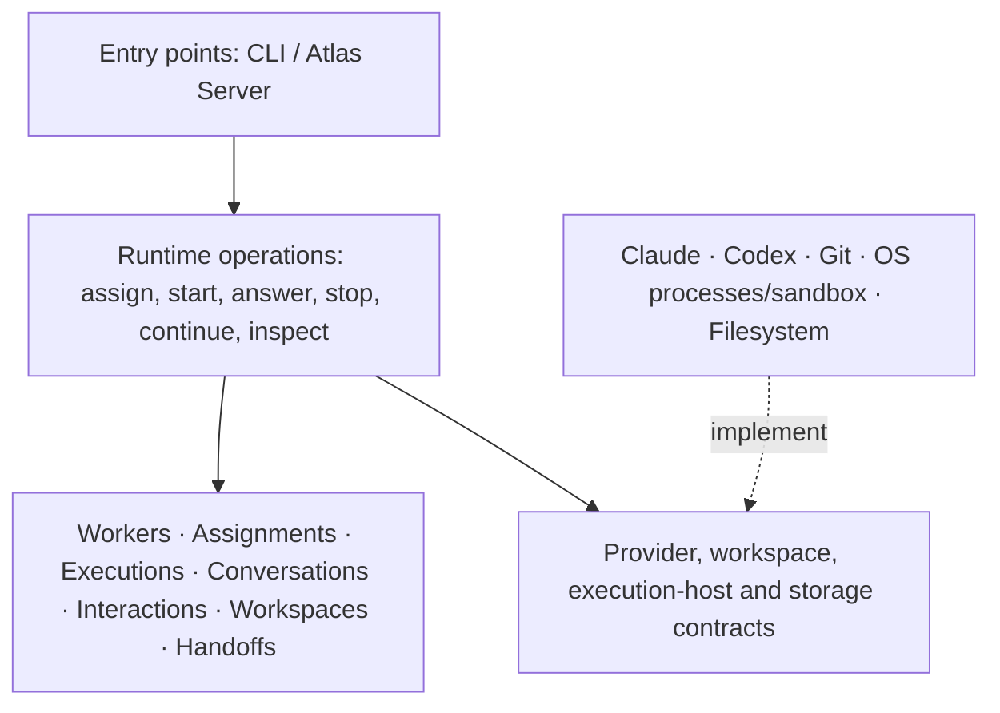

# Runtime architecture

Status: proposed target architecture, recorded from the architecture discussion with Melle. This document does not claim that the current implementation has these boundaries, nor authorize a refactor or permission changes.

## Purpose: make the architecture express the product

Runtime is a worker-execution system, not a collection of CLI wrappers. Its source structure should expose workers, assignments, executions, conversations, interactions, workspaces and handoffs. Provider names, transport protocols, process management and storage formats are implementation details below those concepts.

This is the intent of **screaming architecture**: opening the codebase should reveal what Runtime does, rather than which frameworks or external tools it uses.

Not every domain concept needs a separate layer, application, process or service. Concepts describe the business of Runtime; layers separate responsibilities and dependency direction. Prefer the smallest implementation that preserves those boundaries.

## Ownership boundary

**Runtime owns execution mechanics:** native sessions, execution identity and lifecycle, workspace preparation, permission enforcement, provider selection, local quota eligibility, interaction delivery evidence, durable records and execution events.

**Atlas Server owns orchestration:** work queues, dependencies, assignment selection, workflow gates, acceptance, merge/release policy and escalation rules. A locally installed orchestration server is Atlas Server, not a second workflow engine inside Runtime.

**Console and other clients present state and request permitted operations.** The temporary external coordinator uses the same Runtime interface that Atlas Server should consume. Neither Markdown instructions nor model output authorize workflow transitions.

## Domain concepts

| Concept | Responsibility and boundary |
|---|---|
| Worker | Stable identity across assignments. Identifies the current execution; does not select work from a queue. |
| Assignment | Explicit work request: instructions, repository, base revision and required capabilities. An assignment is not a native conversation. |
| Execution | One attempt to perform an assignment. Owns lifecycle, cancellation, outcome and failure. Distinct from worker identity. |
| Conversation | Provider-bound native session and continuation context. May be reused only when its identity, workspace and permissions remain compatible. |
| Interaction | A question and its answer, including admission, delivery, processing and invalidation evidence, bound to exact executions. |
| Workspace | Repository acquisition, fresh branches, ownership and continuation compatibility. Does not choose assignments or merge work. |
| Execution policy | Local provider/model selection, quota eligibility, fallback and capability requirements. Cannot silently weaken permissions or required capabilities. |
| Handoff | Declared completion or PR result, revisions, verification evidence, limits and remaining processes. A handoff is not acceptance or merge. |

Events and persistence support these concepts. They should not become the primary organizing idea of the architecture.

## Layers and dependencies

The arrows describe dependencies, not a requirement that every request traverse every box. Domain rules must not import provider implementations, subprocess protocols or transport formats. Adapters implement contracts owned by the Runtime core.

### 1. Domain: what Runtime means

The domain defines identity, state transitions and invariants:

- A worker has at most one active execution.
- An answer targets one question in one exact execution; it must not reach a replacement attempt implicitly.
- Continuation preserves a compatible conversation, workspace and permission scope.
- Stopping an execution invalidates its pending interactions.
- Execution completion does not imply task acceptance or successful verification.
- Recording a handoff does not merge a PR or issue a new assignment.
- Delivery, native processing and verified task success are distinct facts.
- Unknown outcomes remain unknown; they are not permission to replay side effects.

No provider names, shell commands, socket formats or filesystem serialization belong in these rules.

### 2. Runtime operations: what callers can do

Application operations coordinate domain transitions and infrastructure:

- Admit an explicit assignment and start execution.
- Continue a compatible conversation.
- Answer an exact pending question.
- Stop an owned execution.
- Submit or inspect a handoff.
- Inspect execution state, output and history.
- Reconstruct durable state after reconnect.

This layer handles request identity, admission ordering and deduplication. Those rules must not be reimplemented separately in provider adapters. Durable admission is not proof that a provider executed a task, and uncertain launch outcomes must not cause automatic redispatch.

It does not select backlog work, approve results, merge PRs or deploy. Those remain orchestration responsibilities.

### 3. Contracts: what Runtime requires from infrastructure

The provider contract should cover the complete execution and interaction lifecycle:

- Describe capabilities before admission.
- Start or resume a native conversation.
- Emit normalized identity, output, question, completion and failure events.
- Deliver an answer to the exact native interaction and report the evidence the provider actually exposes.
- Stop execution through the owned execution-host mechanism.

Runtime asks whether a provider supports active questions; it must not encode that rule as `backend == "claude"`. Claude and Codex translate their native protocols into the same Runtime interaction contract. They must not introduce separate question stores or parallel public APIs.

Capability differences remain explicit. A provider that cannot satisfy an assignment's required interaction or permission contract must refuse before execution where possible. Fallback cannot silently discard those requirements. Changing providers starts a new conversation with an explicit handoff; it is not continuation of the old native session.

Separate infrastructure contracts cover workspace preparation, execution hosting and storage. These are dependency boundaries, not justification for a plugin platform or generic framework.

### 4. Adapters: how execution happens

| Adapter | Responsibility |
|---|---|
| Claude | Translate Claude's native protocol, session configuration and interaction evidence into Runtime contracts. |
| Codex | Translate Codex's native protocol, session configuration and interaction evidence into the same contracts. |
| Git workspace | Prepare repositories and branches, and inspect ownership and compatibility. |
| Execution host | Own OS processes and process groups, signals, environment setup and application of the authorized sandbox. |
| Storage | Persist domain records and event replay with explicit durability and retention limits. |

Provider-specific sandbox configuration may require provider-specific translation, but the authorized scope and enforcement contract must remain explicit. An adapter must not expand permissions to make an operation succeed.

The target implementation is Elixir and Go: Elixir owns lifecycle and state; Go owns the native integration responsibilities as their boundaries are established. The finished architecture contains no Python and introduces no Rust. Python remains temporarily while responsibilities move out of the mixed runner one bounded, runnable slice at a time. A language rewrite is not a substitute for establishing the boundary first.

### 5. Entry points: how callers reach Runtime

The CLI and Atlas Server-facing transport translate requests into the same application operations and expose their results. They should not each implement a worker manager, provider-selection policy or interaction lifecycle.

Transport-specific parsing and presentation remain at the edge. A truncated status summary must not substitute for full output or a structured handoff record.

## Current implementation versus this target

The inspected standalone path is:

`Go CLI → AtlasRuntime.Service → Agent.Native → native_runner.py → provider CLI`

Durable admission, question, peer-correlation, handoff and event modules support the service. There is an existing `AtlasRuntime.Agent` behaviour, but its lifecycle/guidance interface does not expose the standalone question/answer contract.

Observed boundary problems:

- `Service` checks for Claude directly when admitting or handling questions.
- `Service` calls `Agent.Native.answer` directly.
- Provider differences are handled in branches inside shared native code.
- Workspace validation, ownership and Git preparation now live in `native_workspace.py`; the Python runner still combines sandbox setup, process execution and native protocol translation.
- Provider-neutral public command names therefore do not establish a complete provider-neutral implementation boundary.

These observations concern the inspected standalone path. They are not a complete audit of the separate connected Engine/Turn path, and this proposal does not claim those paths already share one implementation.

## First architectural move

The first implemented boundary is workspace preparation and ownership in `beam/apps/atlas_runtime/priv/native_workspace.py`. It owns dedicated-root and repository-request validation, exclusive repository locking, clone/fetch/fresh-branch preparation and continuation preservation. Both Claude and Codex use this same implementation. Existing Elixir admission and lifecycle APIs are unchanged.

The runner supplies an explicit sandbox command prefix to `prepare_repository(scope, repository, created, command_prefix)`. The workspace module owns Git arguments and workspace validation, not provider selection or sandbox translation. It returns the prepared repository record, including the fetched base SHA, or refuses without silently resetting, stashing or overwriting work. The runner retains the returned ownership descriptor until execution ends.

The next Go migration slice is this workspace responsibility, preserving its request/scope/repository records, exact refusal semantics, exclusive ownership lifetime and sandboxed Git execution. Translate that boundary rather than porting the whole runner. Provider protocol and host-process separation remain subsequent work; lifecycle and durable state stay in Elixir.

The shared provider capability and interaction contract remains a separate architectural goal. Codex question support is not part of this extraction. Preserve execution identity, permission checks, error handling, delivery evidence and durable records; do not claim provider parity before exercising the same consumer-visible behavior through both adapters.

## Authorized macOS Claude TLS allowance

Claude dedicated-repository settings allow only `com.apple.trustd.agent` through `sandbox.network.allowMachLookup` on macOS. This fixes the observed native `gh` certificate-validation failure without disabling TLS verification or the sandbox. Other platforms receive no Mach lookup allowance.

The allowance applies to every sandboxed command, not only `gh`. Access to the host trust service permits service-mediated networking, so effective isolation is weaker than a strict GitHub-only network boundary. The existing allowed domains, filesystem restrictions, fail-closed setting and prohibition on unsandboxed commands remain unchanged. This is one explicitly authorized allowance, not permission for adapters to widen scope automatically.

## Explicit non-goals

- Orchestration or LLM-interpreted workflow authority inside Runtime.
- Automatic assignment, merge, release or retry of uncertain side effects.
- Additional permission expansion beyond the explicitly authorized TLS allowance, new providers or a generic plugin framework.
- Claims of exactly-once provider execution or automatic crash restoration.
- Treating coordinator-routed peer records as authenticated native peer delivery.
- Treating stored declarations as independently verified results.

Written by an AI agent (omp · openai-codex/gpt-6-astra).
