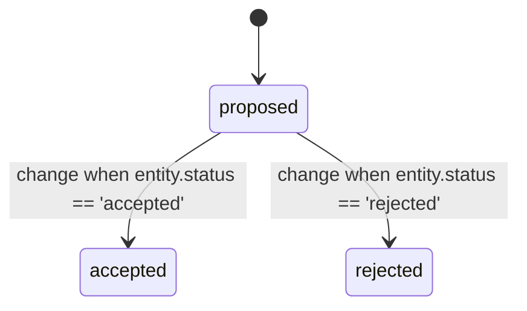

<!-- Generated by atlas (mix atlas.flow.gen) from flow/contract/lib/software.ex, flow/contract/lib/issue.ex, flow/contract/lib/pull_request.ex, flow/contract/lib/pr_review.ex, flow/contract/lib/pr_test.ex, flow/contract/lib/use_case.ex, flow/contract/lib/scene.ex, flow/contract/lib/decision.ex. Do not edit: change the contract and regenerate. -->
# Decide (`decide`)

The state diagram as `rela flow show decide` draws it. Rela flow version: `cb97f2f2854e9ea1`.

