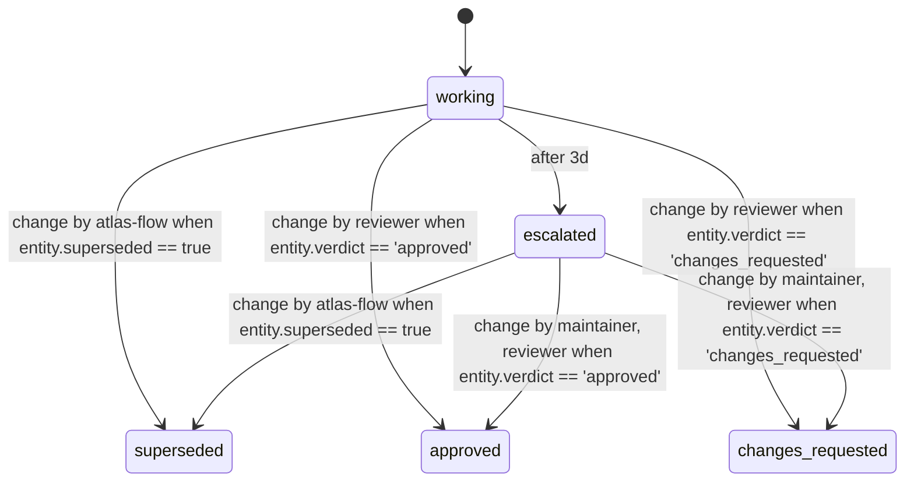

<!-- Generated by atlas (mix model.gen) from model/contract/lib/software.ex, model/contract/lib/issue.ex, model/contract/lib/pull_request.ex, model/contract/lib/pr_review.ex, model/contract/lib/pr_test.ex, model/contract/lib/use_case.ex, model/contract/lib/scene.ex, model/contract/lib/decision.ex. Do not edit: change the contract and regenerate. -->
# PR review (`pr_review`)

The state diagram as `rela flow show pr_review` draws it. Rela flow version: `f8969c0536e1442b`.

