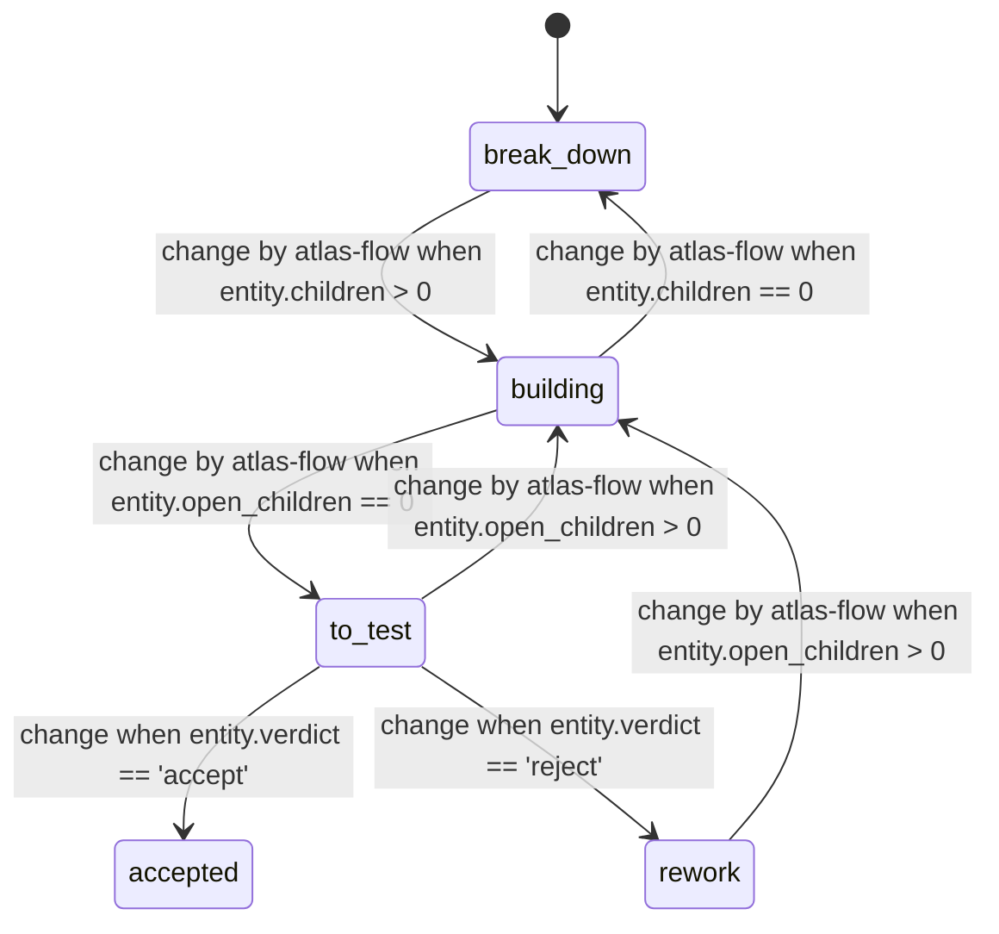

<!-- Generated by atlas (mix model.gen) from model/contract/compositions/atlas_eyra.ex, model/contract/software/issue.ex, model/contract/software/pull_request.ex, model/contract/software/pr_review.ex, model/contract/software/pr_test.ex, model/contract/eyra/use_case.ex, model/contract/eyra/scene.ex, model/contract/foundation/decision.ex, model/contract/software/follow_through.ex. Do not edit: change the contract and regenerate. -->
# Build, test and accept (`test_and_accept_scene`)

The state diagram as `rela flow show test_and_accept_scene` draws it. Rela flow version: `b3c10271c51b8945`.

