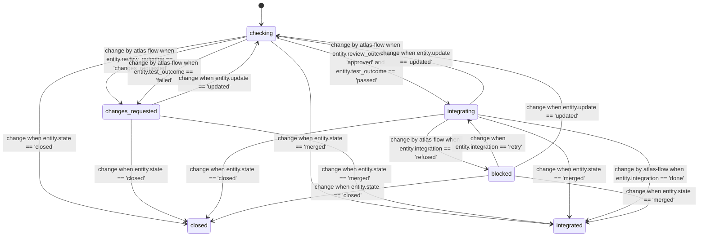

<!-- Generated by atlas (mix model.gen) from products/software_factory/model/contract/compositions/atlas_eyra.ex, products/software_factory/model/contract/software/delivery.ex, products/software_factory/model/contract/software/pull_request.ex, products/software_factory/model/contract/software/pr_review.ex, products/software_factory/model/contract/software/pr_test.ex, products/software_factory/model/contract/eyra/use_case.ex, products/software_factory/model/contract/eyra/scene.ex, products/software_factory/model/contract/foundation/decision.ex, products/software_factory/model/contract/software/follow_through.ex, products/software_factory/model/contract/foundation/to_do.ex, products/software_factory/model/contract/software/package.ex, products/software_factory/model/contract/foundation/runtime_upgrade.ex. Do not edit: change the contract and regenerate. -->
# Pull request (`pull_request`)

The state diagram as `rela flow show pull_request` draws it. Rela flow version: `0ef9fa7df6aab982`.

