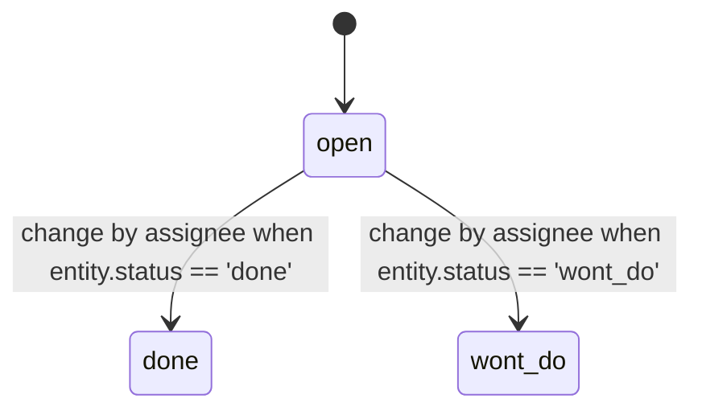

<!-- Generated by atlas (mix model.gen) from products/software_factory/model/compositions/atlas_eyra.ex, products/software_factory/model/software/delivery.ex, products/software_factory/model/software/pull_request.ex, products/software_factory/model/software/pr_review.ex, products/software_factory/model/software/pr_test.ex, products/software_factory/model/eyra/use_case.ex, products/software_factory/model/eyra/scene.ex, products/software_factory/model/foundation/decision.ex, products/software_factory/model/software/follow_through.ex, products/software_factory/model/foundation/to_do.ex. Do not edit: change the contract and regenerate. -->
# To-Do (`to_do`)

The state diagram as `rela flow show to_do` draws it. Rela flow version: `c8e174fc1ec59364`.

